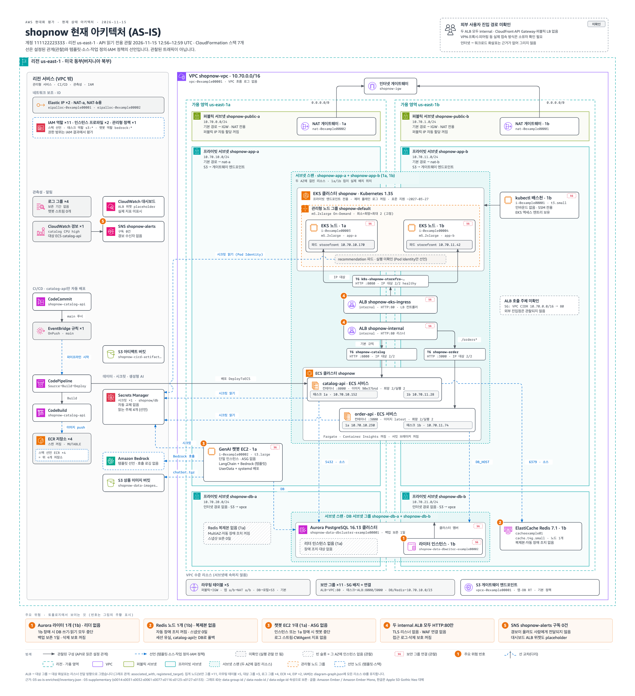

# AWS Modernization Assessment Skills

[English](README.md) · **한국어**

워크로드 하나를 대상으로 AWS 현대화 평가를 수행하는 에이전트 스킬입니다. 매번 같은 절차로 진행되고, 판단마다 근거가
남습니다. **Kiro CLI, Claude Code, Codex** 중 사용하는 도구에 설치한 뒤 평가할 계정과 워크로드를 알려 주면 보고서 한
부가 만들어집니다. 보고서에는 쉽게 풀어 쓴 핵심 문제, 현재 아키텍처, Well-Architected 6개 영역의 정성 등급, 근거가 붙은
점검 결과, 보안 권고, 다섯 Specialist SA Agent의 분야별 제언(각각 아키텍처 다이어그램 포함), 종합 목표 아키텍처, 참고
자료가 담깁니다.

분석과 보고서 작성은 에이전트가 맡고, 매번 같은 결과가 나와야 하는 수집, 점검, 등급 산정, 렌더링, 검증은 헬퍼 스크립트가
처리합니다. 헬퍼 스크립트만 따로 실행해서는 평가가 완성되지 않습니다.

> **운영 환경용이 아닌 샘플 코드입니다.** 이 저장소는 하나의 접근 방식을 보여 드리기 위한 샘플 코드입니다. 실제 환경에
> 적용하기 전에 보안, 법무, 컴플라이언스 담당 부서와 함께 검토하시고, 평가 권한을 받은 계정에서만 실행하시기 바랍니다.
> 보고서는 AI의 도움을 받아 작성한 초안입니다.




*현재 구성 다이어그램입니다. 이미지를 열면 원래 크기로 볼 수 있습니다.*

데모 보고서 전체는 [docs/examples/assessment-orders-ko.html](docs/examples/assessment-orders-ko.html)(이전 버전,
한국어)과 [docs/examples/assessment-shopnow-en.html](docs/examples/assessment-shopnow-en.html)(아래 테스트 실행, 영어)에서
보실 수 있습니다. 계정과 리소스 식별자는 다른 값으로 바꿨고, 읽는 분이 받는 형태 그대로 모든 섹션이 들어 있습니다.

## 만든 이유

현대화 평가는 대개 사람이 직접 자료를 모아 작성합니다. 그래서 몇 주가 걸리고, 같은 워크로드라도 검토자에 따라 결론이
달라지며, 점수의 근거가 함께 전달되지 않는 경우가 많습니다. 권고도 검토자가 익숙한 서비스 쪽으로 기울기 쉽습니다. 이
스킬은 평가 절차를 고정해서, 누가 실행하더라도 같은 기준으로 결과가 나오도록 합니다.

- **점검 결과마다 근거를 남깁니다.** 어떤 리소스에서 어떤 원본 파일을 근거로 판단했는지 밝히고, 그 근거가 API로 읽은
  구성인지, 템플릿이나 소스 코드의 선언인지, 호스트에서 확인한 값인지 구분해 표시합니다. 확인할 수 없는 항목은 추정으로
  채우지 않고 "확인 필요"로 남깁니다.
- **등급마다 이유가 보입니다.** 공개된 규칙에 따라 영역별로 우선 개선, 개선 필요, 주의, 양호, 평가 전 중 하나를 매기고,
  등급 타일마다 그 등급을 결정한 점검 항목을 함께 보여 줍니다. 숫자 점수는 부록에만 둡니다.
- **분야별 전문가 관점으로 검토합니다.** 다섯 Specialist SA Agent가 컨테이너·서버리스, 데이터베이스, 데이터 분석, 생성형
  AI, DevOps 분야를 나눠 맡습니다. 각 에이전트는 AWS 스페셜리스트 SA의 역할로 자기 분야에서 워크로드를 검토하고 제안하는
  변경을 다이어그램으로 그립니다. 제언에는 대상 리소스, 대안(현재 구성을 유지하면서 개선하는 방법도 포함), 원래대로
  되돌리는 방법, 판단 근거가 함께 들어가며, 지금은 바꾸지 않는 편이 낫다는 결론도 가능합니다. 존재하지 않는 근거를
  인용하거나, 출처 없는 금액·일정·개선 효과 수치를 쓰거나, 홍보성 표현이 들어간 제언은 검증 단계에서 걸러집니다. 이
  검토를 바탕으로 일곱 가지 현대화 방향(컨테이너, 서버리스, 관리형 데이터베이스, 관리형 분석, 생성형 AI, 클라우드 네이티브,
  모던 DevOps)마다 권고, 조건부 권고, 권고하지 않음, 평가 전 중 하나로 판단합니다.
- **비용은 공개 요금만 씁니다.** 비용은 AWS Price List API의 공개 온디맨드 요금을 산정 기준과 함께 보여 드리며, 청구액
  예측이 아닙니다. 절감액, 일정, 인일(人日) 같은 추정치는 쓰지 않습니다.
- **기본은 읽기 전용입니다.** describe, list, get 호출과 IAM 정책 시뮬레이터, CloudTrail 이벤트 조회 같은 읽기 호출만
  사용합니다. 예외는 선택 사항인 SSM Run Command 기반 호스트 점검 하나입니다. 자격 증명 값은 어떤 산출물에도 남기지 않고,
  STS로 확인한 계정이 지정한 계정과 다르면 수집을 중단합니다.

## 산출물

```text
artifacts/<workload>/<UTC run id>/
  01-setup/        access-check.json                  계정과 권한 확인 결과
  02-toolkit/      toolkit-check.json                 MCP, 렌더러, 도구 점검 결과
  03-as-is/        inventory.json, raw/, as-is-report.md   구성 근거
  04-review/       findings.json, scorecard.json, review.html, diagrams/
  05-modernization/ specialists/<id>/ (제언, 다이어그램), specialist-advice.json, pathways.json, diagrams/
  06-assessment/   assessment.html, details.html, .md  영어 원본: 3개 섹션 보고서와 상세 페이지
  06-assessment-ko/ assessment.html, details.html       요청한 언어로 만든 보고서(이 예에서는 한국어)
```


통합 보고서는 아래 순서로 구성됩니다.

1. 한눈에 보기: 아래 섹션의 내용을 한 페이지로 요약
2. 핵심 문제: 무엇이 문제인지, 왜 중요한지, 제언, 관련 점검 결과
3. 현재 구성 다이어그램(클릭하면 확대)
4. 계정 수준 현황
5. 영역별 등급
6. 영역별 점검 결과와 영역별 확인 질문
7. 보안 권고: 자체 점검 결과와 가져온 [Service Screener](skills/aws-architecture-review/references/service-screener.md) 결과를 함께 표시
8. Specialist SA Agent 제언: 분야별 아키텍처 다이어그램 포함
9. 종합 목표 아키텍처와 일곱 가지 현대화 방향
10. 참고 자료와 용어
11. 근거(접힌 상태), 그리고 방법·점수·작성 정보를 담은 부록

보고서는 요청한 언어로 작성되며, 영어 원본도 함께 보관됩니다.


| 등급 | 규칙(위에서부터 처음 맞는 규칙을 적용) |
|---|---|
| 우선 개선(Fix first) | 심각도 높음인 미충족(FAIL)이 하나라도 있음 |
| 개선 필요(Needs work) | 미충족이 있거나 주의(WARN)가 3건 이상 |
| 주의(Watch) | 주의가 1~2건이거나 확인 질문(UNKNOWN)이 있음 |
| 양호(Sound) | 판정한 점검이 모두 충족이고 확인 질문이 없음 |
| 평가 전(Unassessed) | 판정한 점검이 없음 |

## 동작 방식

| 단계 | 스킬 | 결과물 |
|---|---|---|
| 0 | [moda-skill](skills/moda-skill/SKILL.template.md) + [aws-skills-install](skills/aws-skills-install/SKILL.md) | `/moda-skill` 진입점과 하위 명령, 해시 검증을 거친 클라이언트 설치, MCP 설정 |
| 1 | [aws-cli-setup](skills/aws-cli-setup/SKILL.md) | 계정과 접근 권한 확인 |
| 2 | [aws-mcp-setup](skills/aws-mcp-setup/SKILL.md) | AWS Knowledge MCP, 함께 쓰는 스킬, 렌더링 도구, 작성 정보 |
| 3 | [aws-as-is-analysis](skills/aws-as-is-analysis/SKILL.md) | 태그가 붙은 모든 서비스 탐색(Resource Groups Tagging API), 기본 서비스와 새로 발견한 서비스의 인벤토리, 계정 수준 현황(Security Hub, GuardDuty, Config, Inspector, Access Analyzer, Compute Optimizer, Trusted Advisor, Health, Organizations, 서비스별 Cost Explorer 비용), 원본 근거, 템플릿과 소스 코드, 선택 사항인 SSH/SSM 호스트 점검 |
| 4 | [aws-architecture-review](skills/aws-architecture-review/SKILL.md) | 6개 영역 점검(엔진·Kubernetes·런타임·OS 지원 종료일, 이전 세대 인스턴스 유형, Classic Load Balancer, 시작 구성, 상용 라이선스, 스택 드리프트 같은 수명 주기 점검과 Flow Logs·CloudFront·ACM 같은 경계 구간 점검 포함), 등급, AWS 스타일의 현재 구성 다이어그램 |
| 5 | [aws-modernization-pathway](skills/aws-modernization-pathway/SKILL.md) | 다섯 Specialist SA Agent의 검토와 다이어그램, 일곱 가지 현대화 방향, AI·관측성·메시징 서비스 적합성, 종합 목표 다이어그램, 통합 보고서 |

각 스킬은 에이전트가 따르는 `SKILL.md`, `scripts/` 아래의 헬퍼 스크립트, `references/` 아래의 참고 문서로 이루어져
있습니다. 단계마다 계정과 실행 ID가 앞 단계와 같은지 확인합니다. 함께 쓰는 스킬인 `aws-diagram-design`과
`aws-bento-deck`은 [고정한 커밋](skills/aws-mcp-setup/assets/dependencies.lock.json) 기준으로 라이선스와 함께 내려받습니다.
아키텍처 다이어그램은 수집한 구성에서 코드(`diagram.py`)가 `aws-diagram-design`의 공식 AWS 아이콘으로 직접 그립니다.
에이전트가 다시 그리지 않습니다.


## 테스트한 클라이언트

2026-11-15에 같은 데모 워크로드(CloudFormation 스택 7개, us-east-1의 리소스 71개)를 대상으로 클라이언트마다 평가를 한 번씩
끝까지 실행했습니다. 세 클라이언트는 같은 계정에서 동시에 실행했고, 프로필은 계정을 변경할 수 있는 권한을 가지고 있었습니다.

| 클라이언트 | 모델 | 소요 시간 | 보고서 | 읽기 전용 가드 |
|---|---|---|---|---|
| Kiro CLI 3.3.0 | `claude-opus-5.5`, effort high | 145분 | Final | 9개 항목 모두 통과 |
| Claude Code 2.1.309(Amazon Bedrock) | Opus 5.5, effort xhigh | 66분 | Final | 9개 항목 모두 통과 |
| Codex CLI 0.155.1(Amazon Bedrock) | `openai.gpt-6-astra`, effort high | 46분 | Final | 9개 항목 모두 통과 |

세 클라이언트 모두 프로필에 변경 권한이 있어 1단계에서 멈췄고, 진행 결정이 기록된 뒤에만 계속했습니다. 평가가 끝난 뒤에는
`create-tags --dry-run`, 시크릿 읽기, 프로필 전환, 설치된 스킬 수정처럼 가드가 막아야 하는 동작 9가지를 에이전트가 직접
시도하게 했습니다. `plan_check.py`의 승인을 먼저 받은 조회 하나를 빼고는 모두 차단되었습니다. 수치는 각각 한 번 실행한
결과이며 벤치마크가 아닙니다. 클라이언트별 진행 단계와 실제 화면은 가이드에 정리했습니다:
[Kiro CLI](docs/guides/kiro-cli.ko.md) · [Claude Code](docs/guides/claude-code.ko.md) · [Codex](docs/guides/codex.ko.md).

## 빠른 시작

명령 하나로 도구를 설치하고, 다른 명령 하나로 사용하는 클라이언트에 맞게 프로젝트를 구성합니다. 그다음부터는
`/moda-skill`(Codex에서는 `$moda-skill`)로 평가 전체를 진행합니다.

클라이언트별 단계 안내는 각 가이드에 정리했습니다:
[Kiro CLI](docs/guides/kiro-cli.ko.md) · [Claude Code](docs/guides/claude-code.ko.md) · [Codex](docs/guides/codex.ko.md).

### 1. 설치

1. 필요한 환경을 확인합니다. Python 3.11 이상(`python3`, Windows에서는 `py -3` 또는 `python`)과 `curl`이
   필요하며, Node와 Bun은 필요 없습니다.
2. 설치 스크립트를 실행합니다.

   macOS, Linux, WSL, AWS CloudShell:

   ```bash
   curl -fsSL https://github.com/aws-samples/sample-modernization-assessment-skills-for-aws/releases/latest/download/install.sh | sh
   ```

   Windows(PowerShell 5.1 또는 7, "관리자 권한으로 실행"이 아닌 일반 창):

   ```powershell
   irm https://github.com/aws-samples/sample-modernization-assessment-skills-for-aws/releases/latest/download/install.ps1 | iex
   ```

3. 설치 스크립트가 안내하면 `~/.local/bin`을 PATH에 추가합니다. 계속 유지하려면 같은 줄을 `~/.zshrc`나
   `~/.bashrc`에 넣어 주세요. Windows에서는 `-NoModifyPath`를 지정하지 않는 한 설치 스크립트가
   `%LOCALAPPDATA%\moda-skill\bin`을 사용자 PATH에 추가합니다.

   ```bash
   export PATH="$HOME/.local/bin:$PATH"
   ```

4. 설치를 확인합니다.

   ```bash
   moda-skill version     # moda-skill 2.2.1
   ```

   `moda-skill` 명령을 찾지 못한다면 설치가 끝까지 진행되지 않은 것입니다.
   `~/.local/share/moda-skill/current`(Windows: `%LOCALAPPDATA%\moda-skill\current`)가 있는지 확인하고 설치
   스크립트를 다시 실행해 주세요. 다운로드나 체크섬 확인에 실패하면 설치 스크립트가 원인을 알려 줍니다.

설치 스크립트가 하는 일:

- 릴리스에서 `moda-skill-<version>.zip`과 `SHA256SUMS`를 내려받아 체크섬을 확인합니다.
- `~/.local/share/moda-skill/versions/<version>/`(Windows: `%LOCALAPPDATA%\moda-skill\versions\`)에 압축을
  풉니다.
- `moda-skill` 실행 파일을 만듭니다. Unix에서는 `~/.local/bin/moda-skill`, Windows에서는
  `%LOCALAPPDATA%\moda-skill\bin` 아래의 `moda-skill.cmd`와 `moda-skill.ps1`입니다.
- Unix에서는 root 권한으로 실행되지 않고, Windows에서는 관리자 권한 창에서 실행하면 경고를 표시합니다.

오프라인 환경이나 다른 호스트에서 설치하는 방법:

- zip과 `SHA256SUMS`를 한 폴더에 두고 `sh install.sh --from moda-skill-2.2.1.zip`(Windows:
  `.\install.ps1 -From .\moda-skill-2.2.1.zip`)을 실행합니다.
- 또는 `VERSION`, zip, `SHA256SUMS`를 제공하는 미러를 지정합니다:
  `MODA_SKILL_BASE_URL=https://<your host>/path sh install.sh`

### 2. 프로젝트 구성

```bash
mkdir my-assessment && cd my-assessment
moda-skill config --harness kiro        # or claude | codex
moda-skill doctor
```

`config`는 단계 스킬 6개와 `/moda-skill` 진입 스킬을 클라이언트의 프로젝트 스킬 폴더(`.kiro/skills`, `.claude/skills`,
`.agents/skills`)에 복사하고, AWS Knowledge MCP 서버를 클라이언트 설정에 추가하며, 고정 커밋의 보조 스킬 2개를
내려받습니다. 프로젝트 폴더 밖은 바꾸지 않습니다. `--scope user`를 지정하면 홈 디렉터리에 설치합니다. `config`는 여러 번
실행해도 문제가 없으며, `--update`를 지정하면 수정하지 않은 이전 사본을 새 버전으로 교체합니다.

`--hooks`를 함께 지정하면 클라이언트에 훅 두 개가 등록됩니다(`.kiro/hooks/moda-skill.json`, `.claude/settings.json` 또는
`.codex/hooks.json`).

- **읽기 전용 가드**는 `aws` 명령이 실행되기 전에 검사해서, describe, list, get 같은 메타데이터 조회가 아니면 실행을
  막습니다. `get-secret-value`나 `s3api get-object`처럼 데이터 내용을 읽는 호출도 막습니다. `bash -c`, `eval`, `xargs`,
  `sudo`, 명령 치환 안에 들어 있는 호출까지 확인하고, AWS를 호출하는 Python·Node.js·PowerShell 인라인 코드는 실행하지
  않으며, `ssm send-command`는 호스트 점검에 쓰는 `AWS-RunShellScript` 문서일 때만 허용합니다. Kiro에서는 내장 도구인
  `use_aws`도 같은 기준으로 검사합니다. 가드가 있으면 읽기 전용 원칙이 에이전트에 대한 지시에만 머물지 않고 훅으로
  실제로 지켜집니다.
- **진행 확인 훅(stop gate)**은 아직 끝나지 않은 단계가 있거나 보고서가 초안 상태이면 에이전트에게 작업을 이어가도록
  요청합니다.

직접 추가한 다른 AWS 도구(예: AWS API MCP 서버)는 가드가 확인하지 못합니다. 어떤 경우에도 확실하게 지켜지는 것은
[권한](#권한)에서 설명하는 읽기 전용 역할입니다. 프로젝트 훅은 클라이언트마다 처음 한 번 신뢰 설정이 필요합니다(Kiro:
워크스페이스 신뢰, Claude Code: 세션 시작 시 승인, Codex: `/hooks`에서 `t`).

훅 명령은 프로젝트 폴더의 절대 경로를 쓰기 때문에, 에이전트가 하위 폴더로 이동해도 가드는 같은 실행을 계속 검사합니다.
프로젝트 폴더를 옮겼다면 `moda-skill config --harness <client> --hooks`를 다시 실행해 주세요.

평가 실행에 `scope.json`이 만들어지면 가드는 더 엄격한 규칙을 적용합니다. 자세한 내용은
[프로필이 계정을 변경할 수 있는 경우](#프로필이-계정을-변경할-수-있는-경우)를 참고하세요. 모든 AWS 호출은 이번 실행의
프로필을 사용해야 하고, 에이전트가 직접 실행하는 AWS 명령은 `plan_check.py`의 승인을 먼저 받아야 합니다. `~/.aws`, 설치된
스킬, 훅 설정, 이번 실행에서 확인한 접근 권한과 결정을 기록한 파일(`01-setup/access-check.json`, `scope.json`, 승인된
명령 목록)도 에이전트가 수정할 수 없습니다.

### 3. 실행

해당 폴더에서 클라이언트를 엽니다. 클라이언트마다 다른 부분은 다음과 같습니다.

| | Kiro CLI | Claude Code | Codex |
|---|---|---|---|
| 실행 | `kiro-cli chat` | `claude` | `codex` |
| 프로젝트 훅 신뢰 | 워크스페이스를 신뢰할지 물으면 신뢰 | 폴더를 신뢰할지 물으면 신뢰, `/hooks`로 확인 | 폴더를 신뢰한 뒤 훅을 검토하고 `t` |
| 명령별 확인 끄기 | `/tools trust-all` | `--dangerously-skip-permissions` | `-a never`, AWS에 접근하도록 `-s danger-full-access` |
| 모델과 effort | `/model`, 설정 패널에서 effort 지정 | `/model`, `--effort high` | `-m <모델> -c model_reasoning_effort=high` |
| 시작 | `/moda-skill start ...` | `/moda-skill start ...` | `$moda-skill start ...` |

평가 한 번에 도구 호출이 수백 번 일어나서 위 표처럼 확인을 끄고 진행합니다. 확인을 꺼도 훅은 모든 셸 명령과 파일 수정을
계속 검사합니다. 그다음 다음과 같이 입력합니다.

> 릴리스 압축을 풀었거나 이 저장소를 복제한 폴더에는 부트스트랩 스킬 두 개(`moda-skill`, `aws-skills-install`)만 들어
> 있습니다. `/moda-skill start`는 먼저 다섯 단계 스킬이 있는지 확인하고, 없으면 해결 방법을 안내한 뒤 멈춥니다. 그 폴더에서
> `moda-skill config --harness <client>`를 실행하고(2단계) 클라이언트를 다시 시작한 다음 다시 시도해 주세요.
> `~/.kiro/skills` 아래에 남아 있는 이전 사본으로 대신하지 마세요. 프로젝트에 설치한 스킬이 우선 적용되고, 오래된 전역
> 사본은 에이전트에 혼란만 줍니다.

```text
/moda-skill start profile assessment region us-east-1 workload shopnow tag Project=shopnow lang ko
```

진입 스킬은 계정을 확인한 뒤 번호를 매긴 메시지 하나로 평가 범위를 확정하고(이미 알려 주신 항목은 다시 묻지 않습니다),
다섯 단계를 차례로 실행해 통합 보고서를 작성합니다. 그 밖의 하위 명령은 다음과 같습니다.

| 명령 | 설명 |
|---|---|
| `/moda-skill` | 현재 실행 상태와 다음 단계 |
| `/moda-skill prepare` | 클라이언트 안에서 스킬, MCP 서버, 보조 스킬을 설치하거나 점검 |
| `/moda-skill start [opts]` | `profile <p> region <r> account <12 digits> workload <n> stack <s> \| tag K=V \| account-wide ssm <i-...> \| no-ssm lang ko\|en use defaults` |
| `/moda-skill status` / `resume` | 단계별 진행 상황 확인 / 끝나지 않은 첫 단계부터 이어서 진행 |
| `/moda-skill report` | 최근 실행의 `06-assessment`를 다시 렌더링 |
| `/moda-skill doctor` / `version` / `help` | 환경 점검 / 설치 버전 확인 / 이 표 보기 |

Codex에서는 `$` 접두사를 씁니다(`$moda-skill start ...`). "prepare moda-skill", "start the assessment", "평가 시작해"
같은 자연어 요청으로도 시작할 수 있습니다.

버전 관리는 `moda-skill list`, `moda-skill use <version>`, `moda-skill rollback`, `moda-skill uninstall --yes`로 합니다.
제거하더라도 프로젝트에 설치한 스킬은 그대로 남습니다.

### 설치 스크립트 없이 사용하기

이 저장소를 `git clone`으로 받아 그 폴더에서 클라이언트를 열어도 됩니다. `.kiro/skills`, `.claude/skills`,
`.agents/skills`에 `moda-skill` 진입 스킬과 설치 스킬이 이미 들어 있어서, 첫 프롬프트부터 `/moda-skill prepare`를 쓸 수
있습니다. Python 3.11 이상, AWS CLI v2, Git, Node.js 18 이상(PNG 내보내기용)이 필요하고, [D2](https://d2lang.com)는
선택 사항입니다. 인증은 SSO 프로필이나 임시 자격 증명을 사용하세요. 자세한 방법은
[aws-cli-setup](skills/aws-cli-setup/SKILL.md)에 있습니다. 자격 증명을 스스로 갱신하는 `assessment` 프로필 설정을
비롯한 CloudShell 사용법은 [docs/CLOUDSHELL.md](docs/CLOUDSHELL.md)에 정리되어 있습니다.

### 권장 모델

이 평가는 최신 프런티어 모델인 **Claude Opus 5.5**(`claude-opus-5.5`)를 effort `high` 이상으로 사용하는 것을 기준으로
설계하고 테스트했습니다. Sonnet 계열 모델을 쓰면 핵심 문제와 권고의 깊이가 눈에 띄게 얕아집니다. Haiku 계열 모델은 단계를 건너뛰는 경우가 있어 도구 동작을 확인하는 정도로만 쓰시길 권합니다.
`/moda-skill start`는 시작 전에 세션의 모델과 effort를 확인하고, 권장 수준보다 낮으면 짧게 안내한 뒤 멈춥니다.
`/moda-skill doctor`에서도 같은 내용을 확인할 수 있습니다. 보고서의 작성 정보에는 사용한 모델이 기록되고, 권장 수준보다
낮은 모델로 만든 보고서에는 그 사실이 표시됩니다. 모델은 `/model`(Kiro, Claude Code)이나 `-m`(Codex)으로 선택합니다.
Kiro CLI에서는 `~/.kiro/settings/cli.json`에 설정된 모델별 effort(`chat.modelDefaults.<model>.output_config.effort`)도
확인해 주세요. 모델 등급은 [skills/moda-skill/assets/models.json](skills/moda-skill/assets/models.json)에 정의되어 있습니다.
Codex는 `openai.gpt-6-astra`(effort high)로 테스트했습니다. OpenAI 모델은 모델 기준에 없어서 `$moda-skill start`가 계속할지
먼저 묻고, 테스트에서는 이 상태로도 Final 보고서까지 만들어졌습니다.

### 평가 후 활용할 만한 요청

> Import the Service Screener result at `<path>/api-full.json` read-only and show it beside the
> local checks in the security chapter, then regenerate 06-assessment.

> Inspect instances `<i-...>` through SSM (inspect_host.py --execute). Do not collect source
> bodies, environment variable values, logs or database data.

> Write the report in Korean. *(다른 언어로도 요청할 수 있으며, 영어 원본은 `06-assessment/`에 그대로 남습니다.)*

## 권한

헬퍼 스크립트는 AWS에서 읽기만 하므로, 모든 리소스를 읽을 수 있는 역할 하나면 충분합니다. 평가 전용
역할(예: 자기 계정을 신뢰하는 `ModernizationAssessmentRole`)을 만들고 다음 두 정책을 연결해 주세요.

1. AWS 관리형 정책 **`ReadOnlyAccess`**("AWS managed - job function" 유형). 스킬이 조회하는 모든 서비스를 포함하고,
   `ViewOnlyAccess`에는 없는 `cloudformation:GetTemplate`과 `codecommit:GetFile`도 들어 있습니다.
2. [`docs/iam/assessment-policy.json`](docs/iam/assessment-policy.json)(인라인 정책). `ReadOnlyAccess`만으로는 허용되는
   데이터 읽기(`s3:GetObject`, `secretsmanager:GetSecretValue`, `dynamodb:Scan`, `logs:GetLogEvents`,
   `lambda:GetFunction`)를 명시적으로 거부합니다. 스킬은 원래 이런 호출을 하지 않지만, Deny를 두면 역할 자체가 이 작업을
   할 수 없게 됩니다. 이 정책은 스킬이 수행하는 유일한 쓰기 작업인 SSM Run Command(선택 사항인 호스트 점검용)도
   허용하는데, 대상은 `AWS-RunShellScript` 문서와 점검하는 인스턴스로 한정됩니다. 평가할 때마다
   `HostInspectionRunShellScriptOnNamedInstances` 문의 `REGION`, `ACCOUNT_ID`, `INSTANCE_ID`를 바꾸거나(호스트당
   인스턴스 ARN 하나), 호스트 점검을 하지 않는다면 이 문을 삭제해 주세요.

CloudShell에서는 이 역할을 사용하는 프로필을 만듭니다. 원본 자격 증명은 컨테이너 자격 증명 공급자가 제공하고 갱신하므로
디스크에 키가 저장되지 않습니다.

```bash
ACCOUNT=$(aws sts get-caller-identity --query Account --output text)
aws configure set role_arn arn:aws:iam::$ACCOUNT:role/ModernizationAssessmentRole --profile assessment
aws configure set credential_source EcsContainer --profile assessment
aws configure set region us-east-1 --profile assessment
aws --profile assessment sts get-caller-identity     # Arn ends in assumed-role/ModernizationAssessmentRole/...
```

그다음 에이전트에게 `profile assessment`를 사용하라고 알려 주시면 됩니다. 호스트 점검을 하려면 대상 인스턴스에 SSM
Agent와 `AmazonSSMManagedInstanceCore` 정책이 연결된 인스턴스 프로파일도 있어야 합니다. 특정 인스턴스로만 제한하려면
`HostInspectionViaSsm`의 `Resource`를 `AWS-RunShellScript` 문서 ARN과 해당 인스턴스 ARN으로 바꿔 주세요.

권한이 없어 거부된 호출이 있어도 평가는 계속됩니다. 수집기는 `access_denied`로 기록하고, 관련 점검은 UNKNOWN으로
처리되며, 보고서에도 그 사실이 표시됩니다. 다만 STS로 확인한 계정이 지정한 계정과 다르면 평가를 중단합니다. 자격
증명은 어떤 산출물에도 기록되지 않으며, 프로필을 사용하면 헬퍼 실행 환경에서 고정 키 환경 변수를 제거합니다.

**수집한 데이터의 저장 위치와 전달 범위.** 헬퍼 스크립트는 모든 결과를 실행한 컴퓨터의 `artifacts/` 아래에만 저장합니다.
다만 에이전트가 이 근거를 읽고 보고서를 작성하므로, 그 내용은 사용하는 에이전트(Kiro CLI, Claude Code, Codex)의 모델
제공자에게 전달됩니다. 이 계정의 메타데이터를 다뤄도 된다고 조직에서 승인한 에이전트를 사용해 주세요. `artifacts/`의
파일에는 계정 ID, ARN, IAM 사용자 이름 같은 식별자가 그대로 들어 있습니다. 보고서에도 계정 ID와 리소스 ARN이 그대로
나오며, 가려지는 것은 IAM 사용자 이름뿐입니다. 폴더와 보고서 모두 계정 소유자의 기밀 정보로 관리하시고, 평가가 끝나면 폴더를
삭제해 주세요.

### 프로필이 계정을 변경할 수 있는 경우

가능하면 위에서 설명한 읽기 전용 역할을 사용해 주세요. 에이전트가 어떻게 동작하든 확실하게 지켜지는 통제는 이것뿐입니다.
관리자 역할이나 IAM 사용자의 액세스 키처럼 계정을 변경할 수 있는 프로필로 실행할 때는 다음 확인 절차가 추가됩니다. 모두
읽기 전용 호출만 사용합니다.

1. **1단계에서 프로필 권한부터 확인합니다.** STS 확인이 끝나면 `verify_access.py`가 IAM 정책 시뮬레이터
   (`iam simulate-principal-policy`, 역할 세션이면 `iam get-role`도 함께)로 대표적인 변경, 데이터 읽기, 자격 증명 작업
   20가지가 허용되는지 확인합니다. 결과는 주체 유형과 함께 `write_capability`(`yes`, `no`, `unknown`)로
   `01-setup/access-check.json`에 기록됩니다. `yes`나 `unknown`이면 에이전트가 작업을 멈추고 읽기 전용 프로필로 바꾸기,
   중단하기, 이 프로필로 계속하기 중 하나를 고르도록 안내합니다. 에이전트가 IAM 리소스를 직접 만들거나 바꾸는 일은
   없습니다. 시뮬레이터는 조직의 SCP와 리소스 기반 정책을 반영하지 않지만, 이 정책들은 권한을 더 제한할 수만 있으므로
   `no`라는 결과는 그대로 믿을 수 있습니다.
2. **수집 헬퍼가 실행되지 않습니다.** 계속 진행하겠다는 결정이 `scope.json`(`write_capable_acknowledged`)에 기록되기
   전까지는 `collect.py`, `supplement.py`, `inspect_host.py --execute`가 시작되지 않습니다. 스킬 파일이 설치 매니페스트와
   다를 때도 마찬가지입니다.
3. **가드가 실행 중인 프로필을 고정합니다.** 모든 AWS 호출은 이번 실행의 프로필을 사용해야 합니다. 자격 증명, 프로필
   파일, 엔드포인트를 바꾸는 환경 변수 설정과, 실행 프로필의 `role_arn`, `source_profile`, SSO 설정 변경은 허용되지
   않습니다. 헬퍼를 거치지 않고 에이전트가 직접 실행하는 AWS 명령은 먼저 `RUN_DIR/agent-commands.json`에 적고
   `plan_check.py`의 승인을 받아야 합니다. `plan_check.py`는 이번 실행의 프로필과 리전을 쓰는 단순 조회 명령만 승인하며,
   엔드포인트나 TLS 검증을 바꾸는 옵션, 요청 내용을 출력하는 옵션, 로컬 파일을 읽는 옵션은 받아들이지 않습니다. 가드는
   승인된 명령만 그대로 실행되도록 허용합니다.
4. **평가가 끝나면 CloudTrail로 확인합니다.** `write_audit.py`가 `cloudtrail lookup-events`로 평가 기간 동안 실행 주체가
   남긴 `ReadOnly=false` 관리 이벤트를 조회합니다. 대상은 평가 범위의 모든 리전과 us-east-1입니다. 결과는 보고서의 "방법과
   출처" 부분에 변경 없음, 확인된 변경 내역, 조회하지 못한 리전 중 하나로 표시됩니다. 같은 주체로 한 다른 작업(예: 다른
   세션의 배포)도 함께 나타나기 때문에, 변경마다 그 호출을 만든 도구를 표시합니다. CloudTrail에 이벤트가 나타나기까지
   최대 15분이 걸릴 수 있고, 데이터 이벤트는 확인 대상에 포함되지 않습니다.

[테스트 실행](#테스트한-클라이언트)에서 세 클라이언트 모두 이 확인 절차를 거쳤습니다.

## 한계

- 등급, 점수, 현대화 방향 판단은 [평가 방법](skills/aws-architecture-review/references/review-method.md#qualitative-grades)에
  정리된 자체 규칙에 따라 항상 같은 방식으로 산출되지만, AWS Well-Architected Tool의 결과나 보안 인증을 대신하지는 않습니다.
- 핵심 문제와 Specialist SA Agent 제언은 에이전트가 작성합니다. 헬퍼는 인용한 근거가 실제로 있는지 확인하고 근거 없는 금액, 일정, 홍보성 표현을 걸러 내지만, 제언 자체가 옳은지까지 보증하지는
  않습니다.
- 평가 범위는 지정한 워크로드입니다. 애플리케이션 로직과 데이터베이스에 저장된 데이터는 확인하지 않습니다.
- 비용은 산정 기준이 함께 표시된 공개 온디맨드 요금이며, 청구액 예측이 아닙니다. 절감액, 일정, 인일 단위 공수는 추정하지
  않습니다.
- 모델 사용량은 클라이언트의 세션 기록(Kiro CLI, Claude Code, Codex)에서 읽습니다. 기록이 평가의 일부만 담고 있다면
  오해를 줄 수 있는 수치를 보여 주는 대신 그 사실을 적습니다.

## 검증

```bash
python3 -m unittest discover -s tests                              # unit tests (no AWS access)
python3 scripts/validate_bundle.py                                 # SKILL.md front matter, references, assets
python3 skills/aws-skills-install/scripts/build_manifest.py --check   # install manifest matches sources
```

`report_kit.py`의 두 사본은 바이트 단위까지 같아야 하며, 테스트에서 이를 확인합니다. 검증 이력은
[docs/VALIDATION.md](docs/VALIDATION.md)에, 원본 출처와 고정 버전은 [docs/SOURCES.md](docs/SOURCES.md)에 있습니다.

## 기여

[CONTRIBUTING.md](CONTRIBUTING.md)를 참고해 주세요. `skills/` 아래를 수정했다면 매니페스트를 다시 생성하고
(`python3 skills/aws-skills-install/scripts/build_manifest.py`) 위의 세 가지 검증을 실행해 주세요. 스킬 정의와 보고서의
영어 원본은 영어로 작성합니다. 다른 언어로 된 보고서는 스킬 문서를 번역하지 않고, 용어집과 함께 `localize_artifacts.py`로
만듭니다.

## 보안

보안 문제를 발견하셨다면 [CONTRIBUTING.md](CONTRIBUTING.md#security-issue-notifications)의 절차에 따라 알려 주세요.
취약점은 공개 이슈로 등록하지 말아 주시기 바랍니다.

## 라이선스

이 프로젝트는 MIT-0 라이선스를 따릅니다. 자세한 내용은 [LICENSE](LICENSE)를 참고해 주세요. 보조 스킬은 고정한 커밋
기준으로 각자의 라이선스에 따라 내려받으며, 해당 라이선스는
[dependencies.lock.json](skills/aws-mcp-setup/assets/dependencies.lock.json)에 기록되고 설치된 보조 스킬 옆에
`UPSTREAM-LICENSE`로 복사됩니다.
