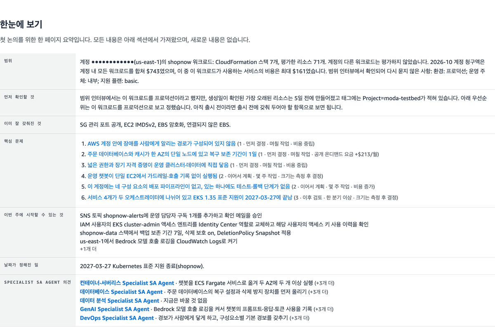
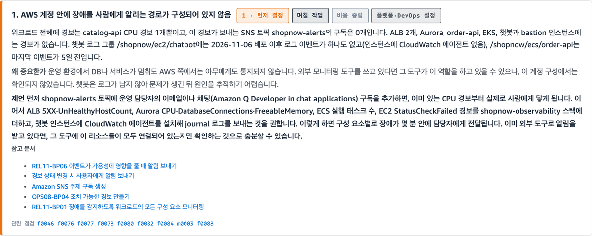
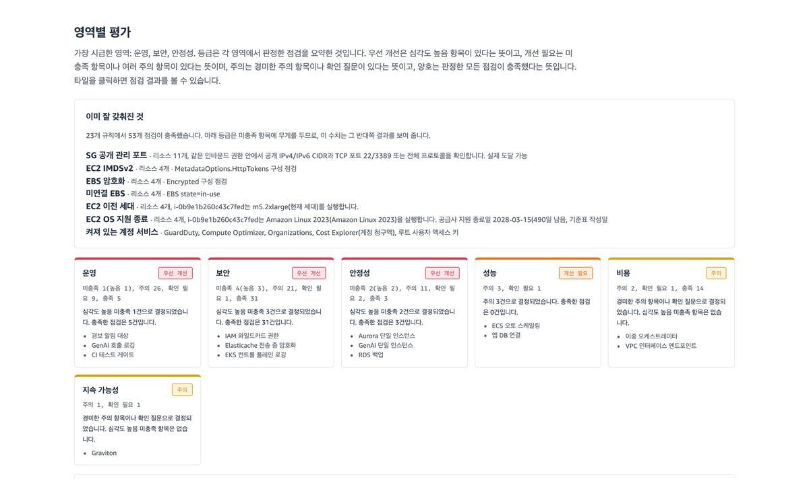
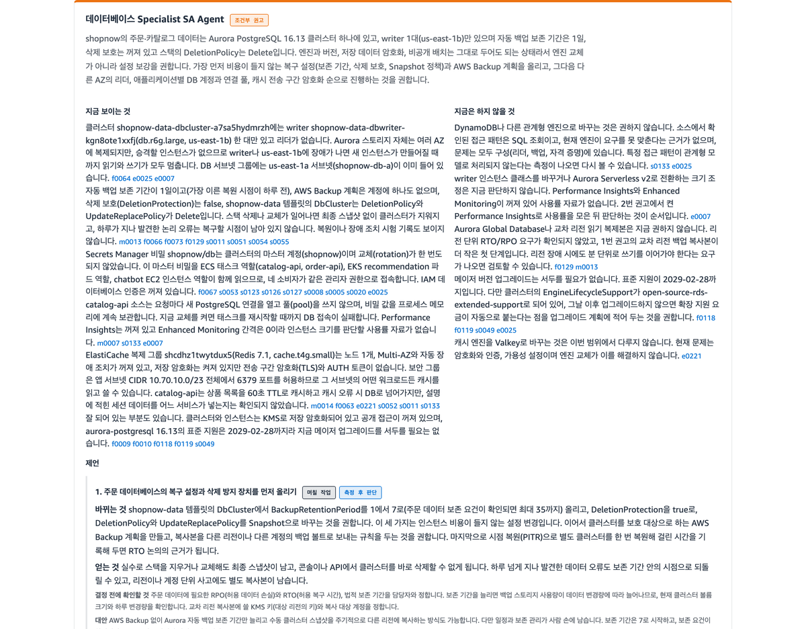
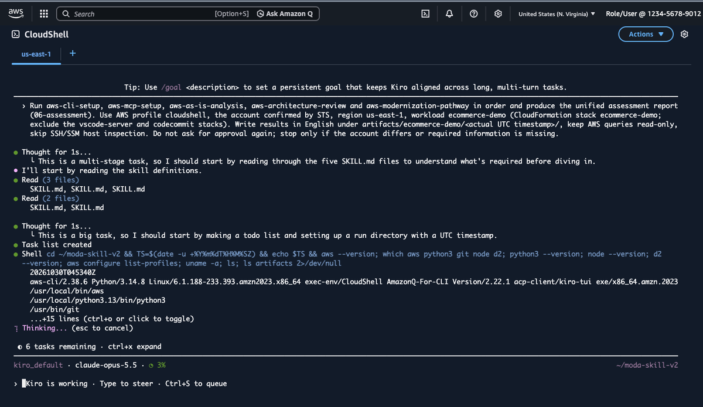

# AWS Modernization Assessment Skills

[English](README.md) · **한국어**

AWS 현대화 평가를 근거가 남는, 반복 가능한 절차로 바꿔 주는 에이전트 스킬입니다. **Kiro CLI, Claude Code, Codex**에
설치하고 에이전트에게 계정과 워크로드를 알려 주면 보고서 하나가 나옵니다. 보고서에는 쉬운 말로 쓴 핵심 문제, 현재
아키텍처, Well-Architected 여섯 영역별 등급, 근거가 붙은 점검 결과, 보안 권고, Specialist SA Agent 5개의 영역별 제언
(각각 아키텍처 다이어그램 포함), 종합 목표 아키텍처, 참고 자료가 들어 있습니다.

분석과 글쓰기는 에이전트가 맡습니다. 헬퍼 스크립트는 매번 똑같아야 하는 일(수집, 점검, 등급, 렌더링, 검증)을 맡습니다.
헬퍼만 따로 실행한 결과는 평가가 아닙니다.

> **샘플 코드이며 운영 환경용이 아닙니다.** 이 저장소는 하나의 접근 방식을 보여 주는 샘플 코드로 제공됩니다. 자신의
> 환경에서 쓰기 전에 보안·법무·컴플라이언스 담당과 검토하고, 평가 권한이 있는 계정에만 실행하세요. 보고서는 AI의 도움을
> 받아 쓴 초안이며, 고객에게 전달하기 전에 평가를 맡은 아키텍트가 확인합니다.





이전 버전으로 만든 보고서 전체 예시는 [docs/examples/assessment-orders-ko.html](docs/examples/assessment-orders-ko.html)에
있습니다(한국어, 데모 워크로드 "orders", 계정과 리소스 식별자는 가렸습니다). 핵심 문제, 현재 구성 다이어그램, 영역별
등급, 점검 결과, 보안 권고가 실제 전달되는 모습 그대로 들어 있습니다. 위 화면의 한눈에 보기와 Specialist SA Agent 섹션은
2.1.14와 2.2에서 추가되었습니다.

## 왜 만들었나

현대화 평가는 보통 사람이 손으로 만듭니다. 몇 주가 걸리고, 검토자가 둘이면 보고서도 두 가지가 나오고, 점수는 근거 없이
전달되며, 권고는 검토자가 잘 아는 쪽으로 기웁니다. 이 스킬은 사람이 아니라 절차를 고정합니다.

- **모든 주장에 출처가 있습니다.** 점검 결과마다 리소스와 원본 근거 파일을 밝히고, 그 근거가 API 구성인지, 템플릿·소스
  선언인지, 호스트 측정인지 표시합니다. 모르는 것은 모르는 것으로 남고, 헬퍼는 추정하지 않습니다.
- **설명할 수 있는 등급입니다.** 영역은 공개된 규칙에 따라 우선 개선, 개선 필요, 주의, 양호, 평가 전으로 등급이 매겨지고,
  각 타일에 그 등급을 정한 이유가 적힙니다. 숫자 점수는 부록에만 있습니다.
- **구호가 아니라 영역 전문가의 제언입니다.** Specialist SA Agent 5개(컨테이너·서버리스, 데이터베이스, 데이터 분석,
  GenAI, DevOps)는 각각 AWS 스페셜리스트 SA의 역할을 맡은 AI 에이전트로, 자기 영역에서 워크로드를 검토하고 변경 내용을
  그림으로 그립니다. 제언마다 대상 리소스, 대안(지금 구성을 유지하며 개선하는 것도 대안입니다), 되돌리는 방법, 근거를
  적고, "지금은 하지 않음"도 올바른 답으로 인정합니다. 검사기는 없는 근거, 금액, 일정, 효과 %, 판매 문구가 들어간 제언을
  거부합니다. 일곱 가지 방향(컨테이너, 서버리스, 관리형 데이터베이스, 관리형 분석, 생성형 AI, 클라우드 네이티브, 모던
  DevOps)은 이 검토를 바탕으로 권고, 조건부 권고, 권고하지 않음, 평가 전으로 판정됩니다.
- **지어낸 숫자가 없습니다.** 비용은 AWS Price List API의 공개 온디맨드 요금과 그 산정 기준만 쓰며, 청구 예측이
  아닙니다. 절감액, 날짜, 인일 같은 추정은 쓰지 않습니다.
- **기본은 읽기 전용입니다.** describe/list/get 호출만 하고, 자격 증명 값은 어떤 산출물에도 남기지 않으며, STS로 확인한
  계정이 지정한 계정과 다르면 수집을 멈춥니다.

## 무엇을 받나

```text
artifacts/<workload>/<UTC run id>/
  01-setup/        access-check.json                  계정과 권한 확인
  02-toolkit/      toolkit-check.json                 MCP, 렌더러, 도구 점검
  03-as-is/        inventory.json, raw/, as-is-report.md   구성 근거
  04-review/       findings.json, scorecard.json, review.html, diagrams/
  05-modernization/ specialists/<id>/ (제언, 다이어그램), specialist-advice.json, pathways.json, diagrams/
  06-assessment/   assessment.html, assessment.md     보고서의 영어 원본
  06-assessment-ko/ assessment.html                   요청한 언어(여기서는 한국어)로 된 보고서
```



통합 보고서(`06-assessment/assessment.html`)는 읽는 사람의 순서대로 구성됩니다. 한눈에 보기(아래 섹션에서 가져온 한
페이지) → 핵심 문제(무엇이 문제인가, 왜 중요한가, 제언, 연결된 점검 결과) → 현재 구성 다이어그램(클릭하면 확대) → 계정
수준 현황 → 영역별 등급 → 영역별 점검 결과와 각 영역의 확인 질문 → 보안 권고(자체 점검과 가져온
[Service Screener](skills/aws-architecture-review/references/service-screener.md) 결과를 함께) → Specialist SA Agent
제언(컨테이너·서버리스, 데이터베이스, 데이터 분석, GenAI, DevOps Specialist SA Agent, 각자의 아키텍처 다이어그램 포함)
→ 종합 목표 아키텍처와 일곱 가지 방향 → 참고 자료 → 용어 → 근거(접힘) → 부록(방법, 점수, 작성 정보) 순입니다. 작업 순서는
워크로드 담당자와의 미팅에서 정합니다. 보고서는 요청한 언어로 작성되고, 영어 원본은 따로 보존됩니다.



| 등급 | 규칙(먼저 맞는 규칙 적용) |
|---|---|
| 우선 개선(Fix first) | 심각도 높음인 미충족(FAIL)이 하나라도 있음 |
| 개선 필요(Needs work) | 미충족이 있거나 주의(WARN)가 세 건 이상 |
| 주의(Watch) | 주의가 한두 건이거나, 확인 질문(UNKNOWN)이 있음 |
| 양호(Sound) | 판정한 점검이 모두 충족이고 확인 질문이 없음 |
| 평가 전(Unassessed) | 판정한 점검이 없음 |

이 등급과 0–100 점수는 이 도구의 자체 기준입니다. AWS Well-Architected Tool의 점수나 HRI/MRI 등급이 아닙니다. 전체
기준: [평가 방법](skills/aws-architecture-review/references/review-method.md#qualitative-grades).

## 어떻게 동작하나

| 단계 | 스킬 | 만드는 것 |
|---|---|---|
| 0 | [moda-skill](skills/moda-skill/SKILL.template.md) + [aws-skills-install](skills/aws-skills-install/SKILL.md) | `/moda-skill` 진입점과 하위 명령 연결, 해시를 검증하는 클라이언트 설치, MCP 설정 병합 |
| 1 | [aws-cli-setup](skills/aws-cli-setup/SKILL.md) | 계정과 접근 권한 확인 |
| 2 | [aws-mcp-setup](skills/aws-mcp-setup/SKILL.md) | AWS Knowledge MCP, D2, 렌더링 도구, 작성 정보 |
| 3 | [aws-as-is-analysis](skills/aws-as-is-analysis/SKILL.md) | 태그가 붙은 모든 서비스 탐색(Resource Groups Tagging API), 기본·발견 서비스 인벤토리, 계정 수준 현황(Security Hub, GuardDuty, Config, Inspector, Access Analyzer, Compute Optimizer, Trusted Advisor, Health, Organizations, 서비스별 Cost Explorer 청구액), 원본 근거, 템플릿과 소스, 선택 사항인 SSH/SSM 호스트 점검 |
| 4 | [aws-architecture-review](skills/aws-architecture-review/SKILL.md) | 여섯 영역 점검(엔진·Kubernetes·런타임·OS 지원 종료일, 이전 세대 유형, Classic LB, 시작 구성, 상용 라이선스, 스택 드리프트 같은 수명 주기 점검과 Flow Logs·CloudFront·ACM 같은 경계 점검 포함), 등급, AWS 스타일 현재 구성 다이어그램 |
| 5 | [aws-modernization-pathway](skills/aws-modernization-pathway/SKILL.md) | Specialist SA Agent 5개의 검토와 다이어그램, 일곱 가지 방향, AI·관측성·메시징 적합성, 종합 목표 다이어그램, 통합 보고서 |

각 스킬은 에이전트가 따르는 `SKILL.md`, `scripts/` 아래의 헬퍼 스크립트, `references/` 아래의 참고 자료로 이루어집니다.
단계마다 계정과 실행 ID가 앞 단계와 같은지 확인합니다. 보조 스킬 `aws-diagram-design`과 `aws-bento-deck`은
[고정된 커밋](skills/aws-mcp-setup/assets/dependencies.lock.json)으로 라이선스와 함께 받아 옵니다.



## 빠른 시작

명령 하나로 도구를 설치하고, 명령 하나로 클라이언트용 프로젝트를 구성하면, 그다음 평가 전체는 `/moda-skill`
(Codex에서는 `$moda-skill`)로 진행합니다.

### 1. 설치

> **이 저장소가 공개되기 전에는** 아래 GitHub 릴리스 URL이 404를 돌려줍니다. 전달받은 릴리스 파일
> (`moda-skill-<version>.zip`, `SHA256SUMS`, `install.sh` / `install.ps1`)을 한 폴더에 두고
> `sh install.sh --from ./moda-skill-2.2.1.zip`(Windows: `.\install.ps1 -From .\moda-skill-2.2.1.zip`)을 실행하거나,
> `VERSION`, zip, `SHA256SUMS`를 제공하는 미러를 지정하세요: `MODA_SKILL_BASE_URL=https://<host>/path sh install.sh`.

macOS, Linux, WSL, AWS CloudShell(`python3` 3.11 이상과 `curl` 필요, Node·Bun 불필요):

```bash
curl -fsSL https://github.com/aws-samples/sample-modernization-assessment-skills-for-aws/releases/latest/download/install.sh | sh
export PATH="$HOME/.local/bin:$PATH"     # if the installer says so; add it to ~/.zshrc or ~/.bashrc to keep it
moda-skill version                        # moda-skill 2.2.1
```

Windows(PowerShell 5.1 또는 7, "관리자 권한으로 실행"이 아닌 일반 창):

```powershell
irm https://github.com/aws-samples/sample-modernization-assessment-skills-for-aws/releases/latest/download/install.ps1 | iex
moda-skill version
```

설치 후에도 `moda-skill`을 찾을 수 없다면 설치가 끝나지 않은 것입니다. `~/.local/share/moda-skill/current`(Windows:
`%LOCALAPPDATA%\moda-skill\current`)가 있는지 확인하고 설치를 다시 실행하세요. 다운로드나 체크섬이 실패하면 설치
스크립트가 이유를 출력합니다.

두 설치 스크립트 모두 릴리스에서 `moda-skill-<version>.zip`과 `SHA256SUMS`를 내려받아 체크섬을 확인한 뒤
`~/.local/share/moda-skill/versions/<version>/`(Windows: `%LOCALAPPDATA%\moda-skill\versions\`)에 풀고 `moda-skill`
실행 파일을 만듭니다(`~/.local/bin/moda-skill`; Windows는 `%LOCALAPPDATA%\moda-skill\bin`의 `moda-skill.cmd`와
`moda-skill.ps1`, `-NoModifyPath`를 주지 않으면 사용자 PATH에 추가). Unix 설치 스크립트는 root로 실행하면 거부하고,
Windows 스크립트는 관리자 창에서 경고합니다. 오프라인이거나 다른 호스트에서 받을 때는
`sh install.sh --from moda-skill-2.2.1.zip` / `.\install.ps1 -From .\moda-skill-2.2.1.zip`(zip 옆의 `SHA256SUMS`를
사용)이나 `MODA_SKILL_BASE_URL=https://<your host>/path`를 쓰면 됩니다. 필요한 런타임은 Python 3.11 이상뿐입니다
(Windows에서는 `py -3` 또는 `python`).

### 2. 프로젝트 구성

```bash
mkdir my-assessment && cd my-assessment
moda-skill config --harness kiro        # or claude | codex
moda-skill doctor
```

`config`는 단계 스킬 6개와 `/moda-skill` 진입 스킬을 클라이언트의 프로젝트 스킬 폴더(`.kiro/skills`, `.claude/skills`,
`.agents/skills`)에 복사하고, AWS Knowledge MCP 서버를 클라이언트 설정에 병합하고, 고정된 보조 스킬 2개를 받아 옵니다.
프로젝트 밖은 바꾸지 않습니다. `--scope user`를 주면 홈 디렉터리에 설치합니다. `config`는 다시 실행해도 안전하며,
`--update`는 수정하지 않은 이전 사본을 교체합니다.

`--hooks`는 클라이언트에 훅 두 개를 함께 등록합니다(`.kiro/hooks/moda-skill.json`, `.claude/settings.json` 또는
`.codex/hooks.json`). 하나는 **읽기 전용 가드**로, describe/list/get 메타데이터 호출이 아닌 `aws` 명령을 실행 전에
막습니다(`get-secret-value`나 `s3api get-object` 같은 데이터 읽기도 막습니다). 다른 하나는 **중단 방지 장치**로, 단계가
남았거나 보고서가 초안이면 에이전트에게 계속 진행하도록 요청합니다. 가드 덕분에 "읽기 전용"이 지시가 아니라 장치가
됩니다. 클라이언트마다 프로젝트 훅을 한 번 신뢰해 줘야 합니다(Kiro: 워크스페이스 신뢰, Claude Code: 세션 시작 시 승인,
Codex: `/hooks`에서 `t`).

### 3. 실행

그 폴더에서 클라이언트를 열고(Kiro: `kiro-cli chat` 다음 `/tools trust-all`) 다음을 입력합니다.

> 릴리스를 풀거나 이 저장소를 복제한 폴더에는 부트스트랩 스킬 두 개(`moda-skill`, `aws-skills-install`)만 있습니다.
> `/moda-skill start`는 먼저 다섯 단계 스킬이 있는지 확인하고, 없으면 해결 방법을 알려 주고 멈춥니다. 그 폴더에서
> `moda-skill config --harness <client>`를 실행하고(2단계), 클라이언트를 다시 시작한 뒤 다시 시작하세요.
> `~/.kiro/skills` 아래의 이전 사본으로 대신하지 마세요. 설치된 프로젝트 스킬이 우선하며, 오래된 전역 사본은 에이전트를
> 헷갈리게 할 뿐입니다.

```text
/moda-skill start profile assessment region us-east-1 workload shopnow tag Project=shopnow lang ko
```

진입 스킬은 계정을 확인하고, 번호를 붙인 메시지 하나로 범위를 확정하고(이미 알려 준 항목은 다시 묻지 않습니다), 다섯
단계를 실행한 뒤 통합 보고서를 씁니다. 다른 하위 명령은 다음과 같습니다.

| 명령 | 하는 일 |
|---|---|
| `/moda-skill` | 현재 실행과 다음 단계 |
| `/moda-skill prepare` | 클라이언트 안에서 스킬, MCP 서버, 보조 스킬을 설치하거나 확인 |
| `/moda-skill start [opts]` | `profile <p> region <r> account <12 digits> workload <n> stack <s> \| tag K=V \| account-wide ssm <i-...> \| no-ssm lang ko\|en use defaults` |
| `/moda-skill status` / `resume` | 단계별 진행 상황, 첫 미완료 단계부터 이어서 진행 |
| `/moda-skill report` | 최근 실행의 `06-assessment`를 다시 렌더링 |
| `/moda-skill doctor` / `version` / `help` | 점검, 설치 버전, 이 표 |

Codex에서는 접두사가 `$`입니다: `$moda-skill start ...`. 자연어 요청도 그대로 됩니다("prepare moda-skill",
"start the assessment", "평가 시작해").

버전 관리: `moda-skill list`, `moda-skill use <version>`, `moda-skill rollback`, `moda-skill uninstall --yes`.
제거해도 프로젝트 스킬은 그대로 남습니다.

### 설치 스크립트 없이

이 저장소를 `git clone`하고 그 안에서 클라이언트를 여세요. `.kiro/skills`, `.claude/skills`, `.agents/skills`에 이미
`moda-skill` 진입 스킬과 설치 스킬이 들어 있어 첫 프롬프트부터 `/moda-skill prepare`가 동작합니다. 필요한 것: Python
3.11 이상, AWS CLI v2, Git, Node.js 18 이상(PNG 내보내기), 선택 사항인 [D2](https://d2lang.com). SSO 프로필이나 임시
자격 증명으로 인증하세요. 자세한 내용은 [aws-cli-setup](skills/aws-cli-setup/SKILL.md)에 있습니다. 자격 증명을 스스로
갱신하는 `assessment` 프로필을 포함한 CloudShell 관련 내용은 [docs/CLOUDSHELL.md](docs/CLOUDSHELL.md)에 있습니다.

### 권장 모델

이 평가는 최신 프런티어 모델, 현재 **Claude Opus 5.5**(`claude-opus-5.5`)의 effort `high` 이상을 기준으로 설계하고
테스트했습니다. Sonnet 계열 모델은 핵심 문제와 권고가 눈에 띄게 얕아지고 다이어그램 재시도가 늘어납니다. Haiku 계열
모델은 단계를 건너뛰므로 도구의 동작 확인에만 쓸 만합니다. `/moda-skill start`는 먼저 세션의 모델과 effort를 확인하고,
권장 수준보다 낮으면 한 줄 안내와 함께 멈춥니다. `/moda-skill doctor`도 같은 내용을 보고합니다. 보고서의 작성 정보에는
사용한 모델이 기록되고, 약한 모델로 만든 보고서는 그 사실이 표시되어 읽는 사람이 알 수 있습니다. 모델은 `/model`(Kiro,
Claude Code)이나 `-m`(Codex)으로 정합니다. Kiro CLI에서는 `~/.kiro/settings/cli.json`의 모델별 effort
(`chat.modelDefaults.<model>.output_config.effort`)도 확인하세요. 모델 등급은
[skills/moda-skill/assets/models.json](skills/moda-skill/assets/models.json)에 있습니다.

### 평가 후 쓸 만한 요청

> Import the Service Screener result at `<path>/api-full.json` read-only and show it beside the
> local checks in the security chapter, then regenerate 06-assessment.

> Inspect instances `<i-...>` through SSM (inspect_host.py --execute). Do not collect source
> bodies, environment variable values, logs or database data.

> Write the report in Korean. *(다른 언어도 됩니다. 영어 원본은 그대로 보존됩니다)*

## 권한

헬퍼는 describe/list/get API만 호출하므로 모든 리소스를 읽을 수 있는 역할 하나면 충분합니다. 전용 역할(예:
`ModernizationAssessmentRole`, 자기 계정을 신뢰)을 만들고 두 가지를 붙이세요.

1. AWS 관리형 정책 **`ReadOnlyAccess`**("AWS managed - job function" 유형). 스킬이 조회하는 모든 서비스를 포함하며,
   `ViewOnlyAccess`에는 없는 `cloudformation:GetTemplate`과 `codecommit:GetFile`도 들어 있습니다.
2. [`docs/iam/assessment-policy.json`](docs/iam/assessment-policy.json)을 인라인 정책으로. `ReadOnlyAccess`라면 허용될
   데이터 내용 읽기(`s3:GetObject`, `secretsmanager:GetSecretValue`, `dynamodb:Scan`, `logs:GetLogEvents`,
   `lambda:GetFunction`)를 명시적으로 거부합니다. 스킬은 이런 호출을 하지 않지만, Deny가 있으면 역할 자체가 할 수 없게
   됩니다. 또 스킬이 할 수 있는 유일한 쓰기인, 선택 사항인 호스트 점검용 SSM Run Command를 `AWS-RunShellScript` 문서와
   점검 대상 인스턴스로 범위를 좁혀 허용합니다. 평가마다 `HostInspectionRunShellScriptOnNamedInstances` 문의 `REGION`,
   `ACCOUNT_ID`, `INSTANCE_ID`를 바꾸거나(호스트마다 인스턴스 ARN 하나), 호스트 점검을 하지 않으면 그 문을 지우세요.

CloudShell에서는 프로필이 그 역할을 가리키게 하세요. 컨테이너 자격 증명 공급자가 원본 자격 증명을 제공하고 갱신하므로
키를 어디에도 쓰지 않습니다.

```bash
ACCOUNT=$(aws sts get-caller-identity --query Account --output text)
aws configure set role_arn arn:aws:iam::$ACCOUNT:role/ModernizationAssessmentRole --profile assessment
aws configure set credential_source EcsContainer --profile assessment
aws configure set region us-east-1 --profile assessment
aws --profile assessment sts get-caller-identity     # Arn ends in assumed-role/ModernizationAssessmentRole/...
```

그런 다음 에이전트에게 `profile assessment`를 쓰라고 알려 주세요. 호스트 점검에는 대상 인스턴스에 SSM 에이전트와
`AmazonSSMManagedInstanceCore`가 붙은 인스턴스 프로필도 필요합니다. 특정 인스턴스로 제한하려면 `HostInspectionViaSsm`의
`Resource`를 `AWS-RunShellScript` 문서 ARN과 그 인스턴스 ARN들로 바꾸세요.

거부된 호출이 있어도 실행은 멈추지 않습니다. 수집기가 `access_denied`를 기록하고, 관련 점검은 UNKNOWN이 되며, 보고서에
그 사실이 적힙니다. STS로 확인한 계정이 지정한 계정과 다를 때만 멈춥니다. 자격 증명은 어떤 산출물에도 기록되지 않고,
프로필을 쓰면 환경 변수의 고정 키는 지워집니다.

## 한계

- 등급, 점수, 방향 판정은 문서화된 결정적 자체 규칙이지만, AWS Well-Architected Tool 결과도 보안 인증도 아닙니다.
- 핵심 문제 문장과 Specialist SA Agent 제언은 에이전트가 쓰고, 고객에게 가기 전에 사람이 검토합니다. 헬퍼는 인용한 근거가
  실제로 있는지 확인하고 지어낸 금액, 일정, 판매 문구를 거부하지만, 제언이 옳다는 것까지 증명하지는 않습니다.
- 범위는 지정한 워크로드입니다. 애플리케이션 로직과 데이터베이스 내용은 보지 않습니다.
- 비용은 산정 기준이 붙은 공개 온디맨드 요금이며 청구 예측이 아닙니다. 절감액, 날짜, 인일 단위 공수는 추정하지 않습니다.
- 모델 사용량은 클라이언트의 세션 기록(Kiro CLI, Claude Code, Codex)에서 읽습니다. 기록이 실행 일부만 담고 있으면 오해를
  부를 수치를 보여 주는 대신 그렇다고 적습니다.

## 검증

```bash
python3 -m unittest discover -s tests                              # 176 tests
python3 scripts/validate_bundle.py                                 # SKILL.md front matter, references, assets
python3 skills/aws-skills-install/scripts/build_manifest.py --check   # install manifest matches sources
```

`report_kit.py`의 두 사본은 바이트 단위로 같아야 하며, 테스트가 이를 확인합니다. 검증 이력은
[docs/VALIDATION.md](docs/VALIDATION.md)에, 원본 출처와 고정 버전은 [docs/SOURCES.md](docs/SOURCES.md)에 있습니다.

## 기여

[CONTRIBUTING.md](CONTRIBUTING.md)를 보세요. `skills/` 아래를 수정했다면 매니페스트를 다시 만들고
(`python3 skills/aws-skills-install/scripts/build_manifest.py`) 위의 세 가지 검사를 실행하세요. 스킬 정의와 보고서의
영어 원본은 영어로 씁니다. 다른 언어 결과물은 스킬 문서를 고치지 않고, 용어집과 함께 `localize_artifacts.py`로 만듭니다.

## 보안

보안 문제를 알리는 방법은 [CONTRIBUTING.md](CONTRIBUTING.md#security-issue-notifications)를 보세요. 취약점은 공개
이슈로 올리지 마세요.

이 저장소를 정적 분석하면 보고되는 항목과 그에 대한 조치입니다(2.1.5와 2.1.6).

- **하위 프로세스 사용(Bandit B603/B607, Semgrep subprocess audit).** 이 도구는 AWS CLI, `ssh`, `d2`, `git`을 하위
  프로세스로 실행해서 동작합니다. 모든 호출은 셸이 아닌 리스트 형식이고, 프로그램 이름은 호출 위치에 리터럴로 적으며
  (`["aws", *checked_arguments(argv)]`), 앞선 `shutil.which` 확인과 똑같이 `PATH`로 찾습니다. `checked_arguments()`는
  문자열이 아니거나 제어 문자가 든 인자를 거부하며, 인자는 수집기 자체의 표, AWS 응답에서 다시 읽은 식별자, 먼저 검증한
  CLI 옵션에서만 나옵니다. `moda-skill doctor`는 `doctor.py`를 하위 프로세스로 띄우지 않고 같은 프로세스에서 호출하며,
  도구 버전 확인은 도구마다 리터럴 argv 하나입니다. 테스트는 프로그램 이름을 리터럴로 적는 헬퍼 하나
  (`tests/harness.py`)를 통해서만 프로세스를 띄웁니다(테스트 인터프리터를 가리키는 shim 디렉터리로 찾는 `python3`,
  `sh`, `pwsh`).
- **XML 파싱(B314, use-defused-xml).** XML 파서를 쓰지 않습니다. SVG 다이어그램은 태그·속성 검사
  (`report_kit.scan_svg`, DTD나 엔티티를 처리하지 않는 `html.parser` 기반)로 확인하며, DTD·엔티티 선언, 25 MB가 넘는
  문서, 스크립트, `foreignObject`, 이벤트 핸들러 속성, `#`과 `data:image/` 밖을 가리키는 참조를 거부합니다. 다시
  직렬화하지 않고 원본 텍스트를 그대로 넣습니다.
- **URL 가져오기(B310).** HTTP 클라이언트 호출은 고정된 AWS Knowledge MCP 엔드포인트를 확인하는 것 하나뿐이며,
  `https://`가 아닌 URL은 거부합니다. 설치 스크립트의 `--base-url`은 쿼리나 자격 증명이 없는 https URL이어야 합니다.
- **동적 코드.** 호스트 점검 스크립트는 더 이상 `globals()`를 읽지 않고, 설정은 기본값이 명시된 앞쪽 할당문입니다. 그
  설정을 확인하는 테스트는 `exec` 대신 `ast.literal_eval`로 읽습니다.
- **Playwright 탐색.** 렌더러는 로컬의 자체 완결형 문서를 읽어, 해석되지 않는 예약 도메인(`moda-render.invalid`)의
  고정 주소 하나에서 메모리로 제공합니다. 다른 요청은 모두 중단되므로 `file://` 경로나 네트워크 URL을 열지 않습니다.
- **IAM 샘플 정책.** `ssm:SendCommand`는 `AWS-RunShellScript` 문서와 평가마다 지정한 인스턴스 ARN에만 허용하며, `*`에는
  허용하지 않습니다. 읽기 전용 SSM 작업은 와일드카드를 유지합니다.

이 도구가 AWS에 하는 일은 그대로입니다. `describe`/`list`/`get` 호출만 하며, 수집기마다의 허용 목록과, 훅을 설치했다면
다른 `aws` 명령을 실행 전에 막는 읽기 전용 가드가 이를 강제합니다.

## 라이선스

이 프로젝트는 MIT-0 라이선스를 따릅니다. [LICENSE](LICENSE)를 보세요. 보조 스킬은 고정된 커밋으로 각자의 라이선스에 따라
받아 오며, 라이선스는 [dependencies.lock.json](skills/aws-mcp-setup/assets/dependencies.lock.json)에 기록되고 설치된
보조 스킬 옆에 `UPSTREAM-LICENSE`로 복사됩니다.
