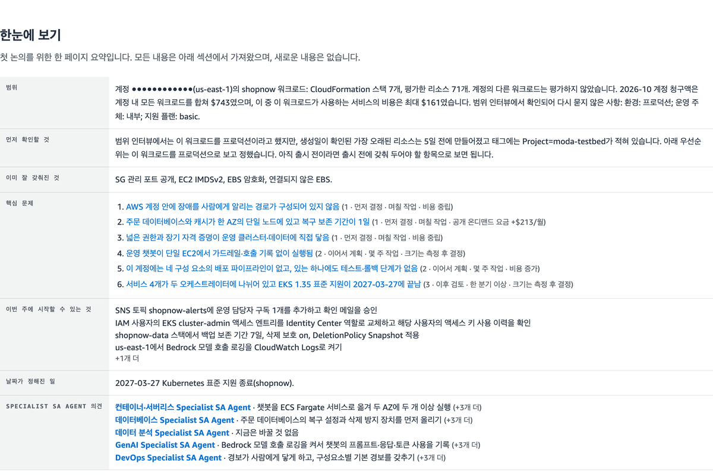
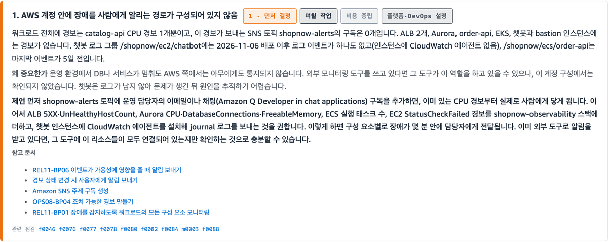
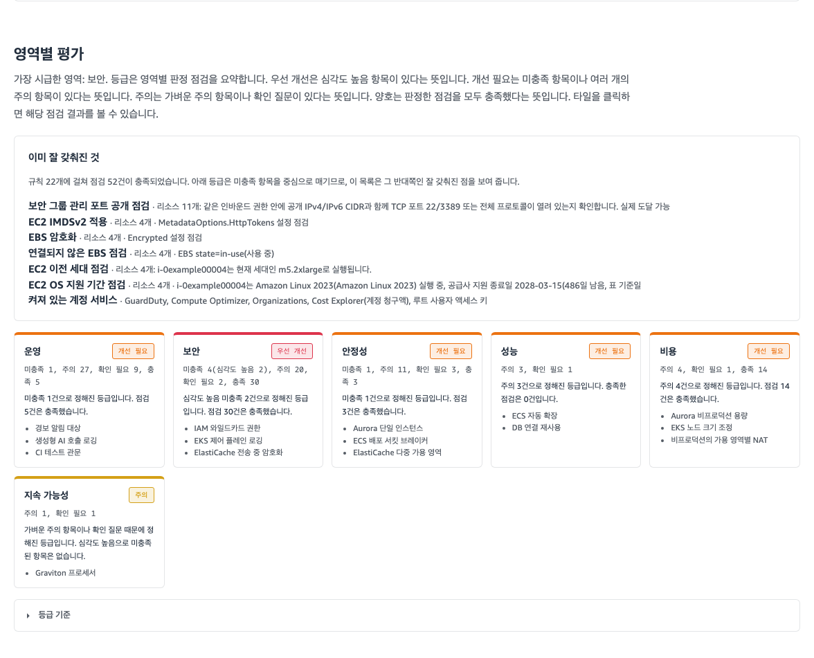
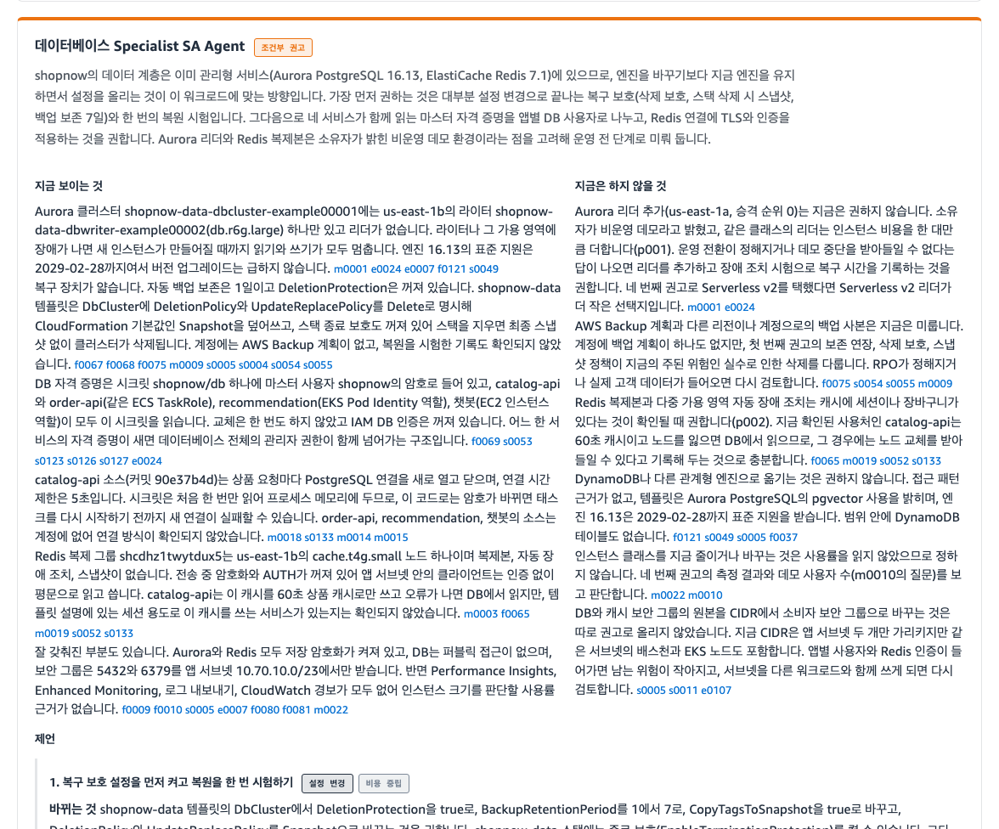

# AWS Modernization Assessment Skills

**English** · [한국어](README.ko.md)

Agent skills that turn an AWS modernization assessment into a repeatable, evidence-backed
procedure. Install them into **Kiro CLI, Claude Code or Codex**, point the agent at an account
and a workload, and get one report: plain-language key issues, the current architecture,
qualitative Well-Architected pillar grades, findings with evidence, security recommendations,
advice from five Specialist SA Agent reviews (each with an architecture diagram), a combined target
architecture, and reference material.

The agent supplies the analysis and the writing. The helper scripts do what must be identical
every time: collect, check, grade, render, verify. Running a helper alone is not an assessment.

> **Sample code, not for production use.** This repository is provided as sample code to show an
> approach. Review it with your security, legal and compliance teams before you use it in your own
> environment, and run it only against accounts you are authorized to assess. Reports are drafts
> written with AI assistance; the assessing architect confirms them before they reach a customer.





*Screenshots: a report produced in Korean (`lang ko`). English-language captures will replace them.*

A complete generated report from an earlier version is in [docs/examples/assessment-orders-ko.html](docs/examples/assessment-orders-ko.html)
(Korean, demo workload "orders"; account and resource identifiers are masked). It shows the key issues,
current-architecture diagram, pillar grades, findings and security recommendations as they are delivered; the
At a glance page and the Specialist SA Agent section shown here were added in 2.1.14 and 2.2.

## Why

Modernization assessments are usually hand-built. They take weeks, two reviewers produce two
different reports, scores arrive without the evidence behind them, and recommendations drift
toward whatever the reviewer knows best. These skills fix the procedure, not the person:

- **Every claim has a source.** Each finding names the resource and the raw evidence file, and
  marks whether it came from API configuration, a template or source declaration, or a
  measurement on the host. Unknown stays unknown; the helpers never estimate.
- **Grades you can explain.** Pillars are graded Fix first, Needs work, Watch, Sound or Unassessed
  by a published rule, and each tile says what set the grade. Numeric scores exist only in the
  appendix.
- **Advice from specialists, not slogans.** Five Specialist SA Agents, AI agents that each take the
  role of an AWS specialist SA (Container & Serverless, Database, Data Analytics, GenAI, DevOps),
  review the workload in their area and draw the change. Every recommendation names the resources,
  an alternative (keeping and improving what exists counts), how to undo it and the evidence;
  "not now" is a valid answer. A validator refuses invented references, amounts, schedules, effect
  percentages and promotional wording. The seven directions (Container, Serverless, Managed
  Database, Managed Analytics, GenAI, Cloud Native, Modern DevOps) are judged candidate,
  conditional, not recommended or not assessed from those reviews.
- **No invented numbers.** Costs are published On-Demand list prices from the AWS Price List API
  with their basis, never a bill forecast; there are no savings estimates, dates or person-days.
- **Read-only by default.** Only describe/list/get calls; credential values are never written to
  any artifact; collection stops if the STS account differs from the one you named.

## What you get

```text
artifacts/<workload>/<UTC run id>/
  01-setup/        access-check.json                  account and permission verification
  02-toolkit/      toolkit-check.json                 MCP, renderer and tool checks
  03-as-is/        inventory.json, raw/, as-is-report.md   configuration evidence
  04-review/       findings.json, scorecard.json, review.html, diagrams/
  05-modernization/ specialists/<id>/ (advice, diagram), specialist-advice.json, pathways.json, diagrams/
  06-assessment/   assessment.html, assessment.md     the English draft of the report
  06-assessment-ko/ assessment.html                   the report in the language you asked for (here Korean)
```



The unified report (`06-assessment/assessment.html`) is ordered for the reader: at a glance
(one page built from the sections below) → key issues (problem, why it matters, suggestion, linked
findings) → current architecture diagram (click to enlarge) → account posture → pillar grades →
findings by pillar, with each pillar's open questions → security recommendations (local checks
beside imported [Service Screener](skills/aws-architecture-review/references/service-screener.md)
results) → Specialist SA Agent recommendations (Container & Serverless, Database, Data Analytics,
GenAI and DevOps Specialist SA Agents, each with its own architecture diagram) → combined target architecture
and the seven directions → reference material → terms →
evidence (folded) → method, scores and run provenance in an appendix. The order of work is left
to the meeting with the workload owner. Reports are written in the language of your request; the
English draft is kept alongside.



| Grade | Rule (first match wins) |
|---|---|
| Fix first | any high-severity FAIL |
| Needs work | any FAIL, or three or more WARN |
| Watch | one or two WARN, or any open question (UNKNOWN) |
| Sound | every judged check PASS and no open question |
| Unassessed | no judged checks |

These grades and the 0–100 scores are local to this toolkit. They are not AWS Well-Architected
Tool scores or HRI/MRI ratings. Full rubric: [review method](skills/aws-architecture-review/references/review-method.md#qualitative-grades).

## How it works

| Stage | Skill | Produces |
|---|---|---|
| 0 | [moda-skill](skills/moda-skill/SKILL.template.md) + [aws-skills-install](skills/aws-skills-install/SKILL.md) | `/moda-skill` entry point and subcommand routing; hash-verified installation into the client, MCP config merge |
| 1 | [aws-cli-setup](skills/aws-cli-setup/SKILL.md) | Verified account and access |
| 2 | [aws-mcp-setup](skills/aws-mcp-setup/SKILL.md) | AWS Knowledge MCP, D2, render tooling, run metadata |
| 3 | [aws-as-is-analysis](skills/aws-as-is-analysis/SKILL.md) | Discovery of every tagged service (Resource Groups Tagging API), inventory of the default and discovered services, account posture (Security Hub, GuardDuty, Config, Inspector, Access Analyzer, Compute Optimizer, Trusted Advisor, Health, Organizations, Cost Explorer bill by service), raw evidence, templates and sources, optional SSH/SSM host inspection |
| 4 | [aws-architecture-review](skills/aws-architecture-review/SKILL.md) | Six-pillar findings incl. lifecycle (engine, Kubernetes, runtime and OS support dates, previous-generation types, Classic LB, launch configurations, commercial licenses, stack drift) and edge checks (flow logs, CloudFront, ACM), grades, AWS-branded current-state diagram |
| 5 | [aws-modernization-pathway](skills/aws-modernization-pathway/SKILL.md) | Five Specialist SA Agent reviews with diagrams, seven directions, AI/observability/messaging fit, combined target diagram, unified report |

Each skill is a `SKILL.md` the agent follows, helper scripts under `scripts/`, and references
under `references/`. Every stage checks that the account and run id match the previous stage.
Two companion skills, `aws-diagram-design` and `aws-bento-deck`, are fetched at
[pinned commits](skills/aws-mcp-setup/assets/dependencies.lock.json) with their licenses.


## Quick start

One command installs the toolkit, one command configures a project for your client, and from then on the
whole assessment is `/moda-skill` (`$moda-skill` in Codex).

### 1. Install

> **Until this repository is public**, the GitHub release URLs below return 404. Use the release files you were
> given (`moda-skill-<version>.zip`, `SHA256SUMS`, `install.sh` / `install.ps1`) from one folder:
> `sh install.sh --from ./moda-skill-2.2.1.zip` (Windows: `.\install.ps1 -From .\moda-skill-2.2.1.zip`), or point
> the installer at a mirror that serves `VERSION`, the zip and `SHA256SUMS`:
> `MODA_SKILL_BASE_URL=https://<host>/path sh install.sh`.

macOS, Linux, WSL or AWS CloudShell (needs `python3` 3.11+ and `curl`; no Node, no Bun):

```bash
curl -fsSL https://github.com/aws-samples/sample-modernization-assessment-skills-for-aws/releases/latest/download/install.sh | sh
export PATH="$HOME/.local/bin:$PATH"     # if the installer says so; add it to ~/.zshrc or ~/.bashrc to keep it
moda-skill version                        # moda-skill 2.2.1
```

Windows (PowerShell 5.1 or 7, a normal window, not "Run as administrator"):

```powershell
irm https://github.com/aws-samples/sample-modernization-assessment-skills-for-aws/releases/latest/download/install.ps1 | iex
moda-skill version
```

If `moda-skill` is not found afterwards, the install did not finish: check `~/.local/share/moda-skill/current`
(Windows: `%LOCALAPPDATA%\moda-skill\current`) exists and re-run the installer; it prints the reason when a
download or checksum fails.

Both installers download `moda-skill-<version>.zip` and `SHA256SUMS` from the release, verify the checksum,
unpack under `~/.local/share/moda-skill/versions/<version>/` (Windows: `%LOCALAPPDATA%\moda-skill\versions\`)
and write the `moda-skill` launcher (`~/.local/bin/moda-skill`; Windows: `moda-skill.cmd` and `moda-skill.ps1`
in `%LOCALAPPDATA%\moda-skill\bin`, added to your user PATH unless `-NoModifyPath`). The Unix installer refuses
to run as root; the Windows one warns in an elevated window. Offline or from another host:
`sh install.sh --from moda-skill-2.2.1.zip` / `.\install.ps1 -From .\moda-skill-2.2.1.zip` (the `SHA256SUMS`
next to the zip is used) or `MODA_SKILL_BASE_URL=https://<your host>/path`. Python 3.11+ is the only runtime
(`py -3` or `python` on Windows).

### 2. Configure a project

```bash
mkdir my-assessment && cd my-assessment
moda-skill config --harness kiro        # or claude | codex
moda-skill doctor
```

`config` copies the six stage skills and the `/moda-skill` entry skill into the client's project skills
directory (`.kiro/skills`, `.claude/skills` or `.agents/skills`), merges the AWS Knowledge MCP server into the
client's config, and fetches the two pinned companion skills. Nothing outside the project changes.
`--scope user` installs into your home directory instead. Re-running `config` is safe; `--update` replaces an
older unmodified copy.

`--hooks` also registers two hooks for the client (`.kiro/hooks/moda-skill.json`, `.claude/settings.json` or
`.codex/hooks.json`): a **read-only guard** that blocks any `aws` command before it runs unless it is a
describe/list/get metadata call (data reads such as `get-secret-value` or `s3api get-object` are blocked too),
and a **stop gate** that asks the agent to keep going while a run has unfinished stages or a draft report. The
guard turns the "read-only" promise from an instruction into a mechanism. In Kiro it also checks the built-in
`use_aws` tool. It does not see other AWS tools you add yourself (for example an AWS API MCP server), so the
read-only role in [Permissions](#permissions) remains the boundary that holds in every case. Each client asks you to trust project
hooks once (Kiro: trust the workspace; Claude Code: accept at session start; Codex: `/hooks`, `t`).

### 3. Run

Open the client in that folder (Kiro: `kiro-cli chat`, then `/tools trust-all`) and type:

> A folder you got by unzipping the release or cloning this repository holds only the two bootstrap skills
> (`moda-skill`, `aws-skills-install`). `/moda-skill start` checks for the five stage skills first and stops
> with the fix if they are absent: run `moda-skill config --harness <client>` in that folder (step 2), restart the
> client, and start again. Do not fall back on older copies under `~/.kiro/skills`; project skills take precedence
> once installed, and stale global copies only confuse the agent.

```text
/moda-skill start profile assessment region us-east-1 workload shopnow tag Project=shopnow lang ko
```

The entry skill verifies the account, confirms the scope in one numbered message (anything you already
named is not asked again), runs the five stages and writes the unified report. Other subcommands:

| Command | What it does |
|---|---|
| `/moda-skill` | current run and the next step |
| `/moda-skill prepare` | install or verify skills, MCP server and companions from inside the client |
| `/moda-skill start [opts]` | `profile <p> region <r> account <12 digits> workload <n> stack <s> \| tag K=V \| account-wide ssm <i-...> \| no-ssm lang ko\|en use defaults` |
| `/moda-skill status` / `resume` | stage-by-stage progress; continue from the first incomplete stage |
| `/moda-skill report` | re-render `06-assessment` for the latest run |
| `/moda-skill doctor` / `version` / `help` | checks, installed version, this table |

In Codex the prefix is `$`: `$moda-skill start ...`. The natural-language triggers still work ("prepare
moda-skill", "start the assessment", "평가 시작해").

Lifecycle: `moda-skill list`, `moda-skill use <version>`, `moda-skill rollback`, `moda-skill uninstall --yes`.
Project skills stay in place on uninstall.

### Without the installer

`git clone` this repository and open your client in it: `.kiro/skills`, `.claude/skills` and
`.agents/skills` already carry the rendered `moda-skill` entry skill and the installer skill, so
`/moda-skill prepare` works from the first prompt. Requirements: Python 3.11+, AWS CLI v2, Git, Node.js 18+
(PNG export), optional [D2](https://d2lang.com). Authenticate with an SSO profile or temporary credentials;
see [aws-cli-setup](skills/aws-cli-setup/SKILL.md). CloudShell specifics, including the `assessment`
profile that refreshes its credentials, are in [docs/CLOUDSHELL.md](docs/CLOUDSHELL.md).

### Recommended model

The assessment is designed and tested on the newest frontier model, currently **Claude Opus 5.5** (`claude-opus-5.5`)
at effort `high` or higher. Sonnet-class models produce visibly shallower key issues and recommendations and need more
diagram retries; Haiku-class models skip stage steps and are only useful for smoke tests of the tooling.
`/moda-skill start` checks the session's model and effort first and stops with a one-line message when they are below
the recommended tier; `/moda-skill doctor` reports the same. The report's provenance section records the model used and
flags a run made with a weaker model, so a reader knows what they are looking at. Set the model with `/model` (Kiro,
Claude Code) or `-m` (Codex); on Kiro CLI also check the per-model effort in `~/.kiro/settings/cli.json`
(`chat.modelDefaults.<model>.output_config.effort`). The tiers live in
[skills/moda-skill/assets/models.json](skills/moda-skill/assets/models.json).

### Useful follow-up prompts

> Import the Service Screener result at `<path>/api-full.json` read-only and show it beside the
> local checks in the security chapter, then regenerate 06-assessment.

> Inspect instances `<i-...>` through SSM (inspect_host.py --execute). Do not collect source
> bodies, environment variable values, logs or database data.

> Write the report in Korean. *(or any language; the English draft is kept in `_canonical-en/`)*

## Permissions

The helpers only call describe/list/get APIs, so one role that can read every resource is
enough. Create a dedicated role (for example `ModernizationAssessmentRole`, trusted by your
account) and attach two things:

1. The AWS managed policy **`ReadOnlyAccess`** (type "AWS managed - job function"). It covers
   every service the skills query, including `cloudformation:GetTemplate` and
   `codecommit:GetFile`, which `ViewOnlyAccess` lacks.
2. [`docs/iam/assessment-policy.json`](docs/iam/assessment-policy.json) as an inline policy.
   It explicitly denies data-content reads that `ReadOnlyAccess` would otherwise permit
   (`s3:GetObject`, `secretsmanager:GetSecretValue`, `dynamodb:Scan`, `logs:GetLogEvents`,
   `lambda:GetFunction`); the skills never make those calls, and the Deny makes the role itself
   unable to. It also allows the one write the skills can perform, SSM Run Command for the
   optional host inspection, scoped to the `AWS-RunShellScript` document and to the instance
   being inspected: replace `REGION`, `ACCOUNT_ID` and `INSTANCE_ID` in the
   `HostInspectionRunShellScriptOnNamedInstances` statement per engagement (one instance ARN
   per host), or delete that statement when host inspection is not used.

In CloudShell, point a profile at that role; the container credential provider supplies and
refreshes the source credentials, so no key is ever written:

```bash
ACCOUNT=$(aws sts get-caller-identity --query Account --output text)
aws configure set role_arn arn:aws:iam::$ACCOUNT:role/ModernizationAssessmentRole --profile assessment
aws configure set credential_source EcsContainer --profile assessment
aws configure set region us-east-1 --profile assessment
aws --profile assessment sts get-caller-identity     # Arn ends in assumed-role/ModernizationAssessmentRole/...
```

Then tell the agent to use `profile assessment`. Host inspection also needs the SSM agent and
an instance profile with `AmazonSSMManagedInstanceCore` on the named instances; to restrict it
to specific instances, replace the `Resource` of `HostInspectionViaSsm` with the
`AWS-RunShellScript` document ARN plus those instance ARNs.

Denied calls do not stop the run: the collector records `access_denied`, the related checks
become UNKNOWN, and the report says so. The run stops only if the STS account differs from the
one you named. Credentials are never written to any artifact, and static keys are stripped from
the environment when a profile is used.

**Where the collected data goes.** The helpers keep everything under `artifacts/` on the machine
that runs them. The agent reads that evidence to write the report, so it is sent to the model
provider behind the agent you use (Kiro CLI, Claude Code or Codex); use one your organization
approves for this account's metadata. `artifacts/` holds unmasked identifiers (account ID, ARNs,
IAM user names); only the report masks the account ID and IAM user names. Handle the folder as the
account owner's confidential data and delete it when the engagement ends.

## Limits

- Grades, scores and pathway verdicts are local rules, deterministic and documented, but not
  AWS Well-Architected Tool results and not a security certification.
- The agent writes the key-issue sentences and the Specialist SA Agent recommendations; a human
  reviews them before they reach a customer. The helpers check that cited references exist and
  refuse invented amounts, schedules and promotional wording, but they do not prove the advice right.
- Scope is the workload you name. Application logic and database contents are not inspected.
- Costs are published On-Demand list prices with their basis, never a bill forecast. Savings,
  dates and effort in person-days are never estimated.
- Model usage is read from the client's own session records (Kiro CLI, Claude Code, Codex). When the
  record covers only part of the run, the report says so instead of showing a misleading figure.

## Verification

```bash
python3 -m unittest discover -s tests                              # 176 tests
python3 scripts/validate_bundle.py                                 # SKILL.md front matter, references, assets
python3 skills/aws-skills-install/scripts/build_manifest.py --check   # install manifest matches sources
```

The two copies of `report_kit.py` must stay byte-identical; a test enforces it. Validation
history is in [docs/VALIDATION.md](docs/VALIDATION.md), upstream sources and pinned versions
in [docs/SOURCES.md](docs/SOURCES.md).

## Contributing

See [CONTRIBUTING.md](CONTRIBUTING.md). After editing anything under `skills/`, rebuild the
manifest (`python3 skills/aws-skills-install/scripts/build_manifest.py`) and run the three
checks above. Skill definitions and canonical report drafts are English; localized output is
produced through `localize_artifacts.py` with the glossary, never by editing the skill text.

## Security

See [CONTRIBUTING.md](CONTRIBUTING.md#security-issue-notifications) for how to report a
security issue. Do not open a public issue for vulnerabilities.

What a static scan of this repository reports, and what was done about it (2.1.5 and 2.1.6):

- **Subprocess use (Bandit B603/B607, Semgrep subprocess audit).** The whole toolkit works by
  running the AWS CLI, `ssh`, `d2` and `git` as child processes. Every call is list form (never a
  shell) with the program name written as a literal at the call site (`["aws", *checked_arguments(argv)]`),
  resolved through `PATH` exactly as the preceding `shutil.which` check resolved it; `checked_arguments()`
  rejects anything that is not a string or carries control characters, and the arguments come from
  the collector's own tables, identifiers read back from AWS responses, or CLI options validated
  first. The `moda-skill doctor` command calls `doctor.py` in-process instead of spawning it, and the
  doctor's version probes are one literal argv per tool. The test suite spawns processes through one
  helper (`tests/harness.py`) that also names its programs literally (`python3` resolved through a
  shim directory that points at the test interpreter, `sh`, `pwsh`).
- **XML parsing (B314, use-defused-xml).** No XML parser is loaded. SVG diagrams are checked with a
  tag and attribute scan (`report_kit.scan_svg`, built on `html.parser`, which performs no DTD or
  entity processing) that refuses DTD or entity declarations, documents over 25 MB, scripts,
  `foreignObject`, event-handler attributes and references outside `#` and `data:image/`; the
  original text is embedded, never a re-serialization.
- **URL fetch (B310).** The only HTTP client call probes the fixed AWS Knowledge MCP endpoint and
  refuses non-`https://` URLs. `--base-url` for the installer must be an https URL without query
  or credentials.
- **Dynamic code.** The host probe no longer reads `globals()`; its configuration is a prepended
  assignment with an explicit default. The test that checked that configuration decodes it with
  `ast.literal_eval` instead of `exec`.
- **Playwright navigation.** The renderer reads the local, self-contained document and serves it
  from memory at one fixed address on a reserved, unresolvable origin (`moda-render.invalid`);
  every other request is aborted, so no `file://` path or network URL is ever opened.
- **IAM sample policy.** `ssm:SendCommand` is granted only for the `AWS-RunShellScript` document
  and the instance ARN(s) named per engagement, never on `*`; the read-only SSM actions keep the
  wildcard.

What the toolkit does to AWS is unchanged: `describe`/`list`/`get` calls only, enforced by an
allowlist in each collector and, when hooks are installed, by the read-only guard that blocks any
other `aws` command before it runs.

## License

This project is licensed under the MIT-0 License. See [LICENSE](LICENSE). Companion skills are
fetched at pinned commits under their own licenses, recorded in
[dependencies.lock.json](skills/aws-mcp-setup/assets/dependencies.lock.json) and copied next to
each installed companion as `UPSTREAM-LICENSE`.
