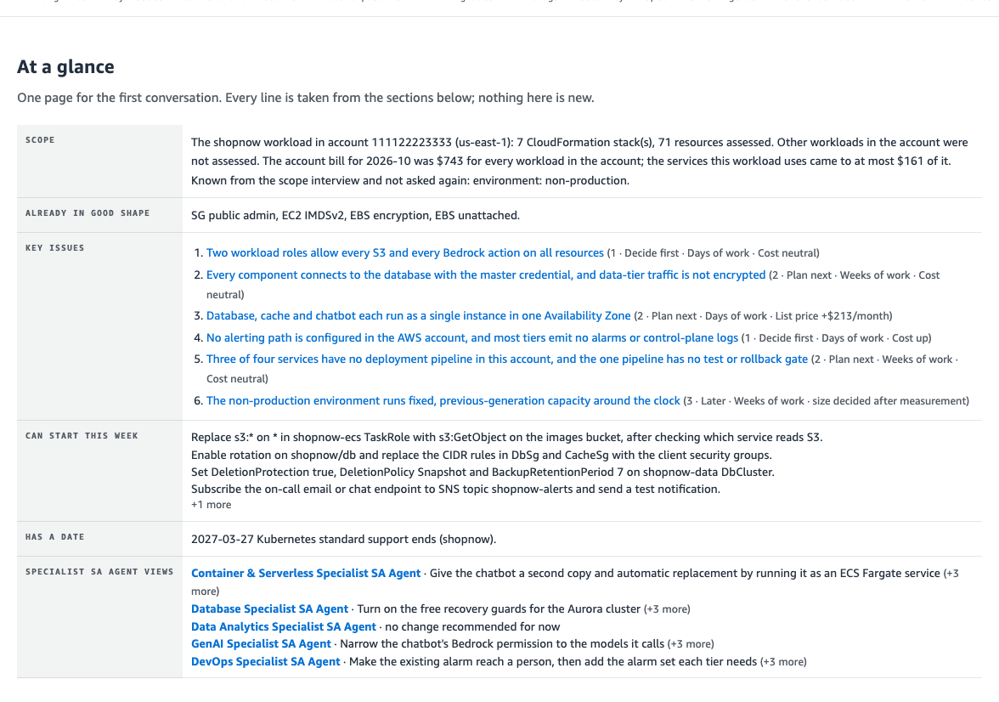
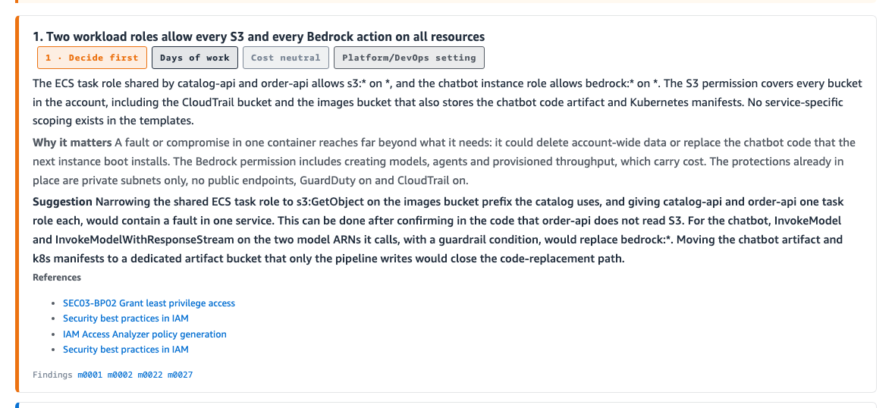
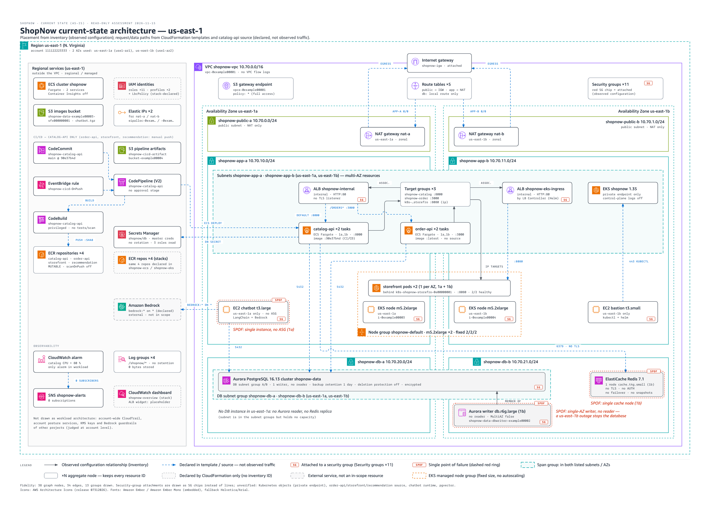
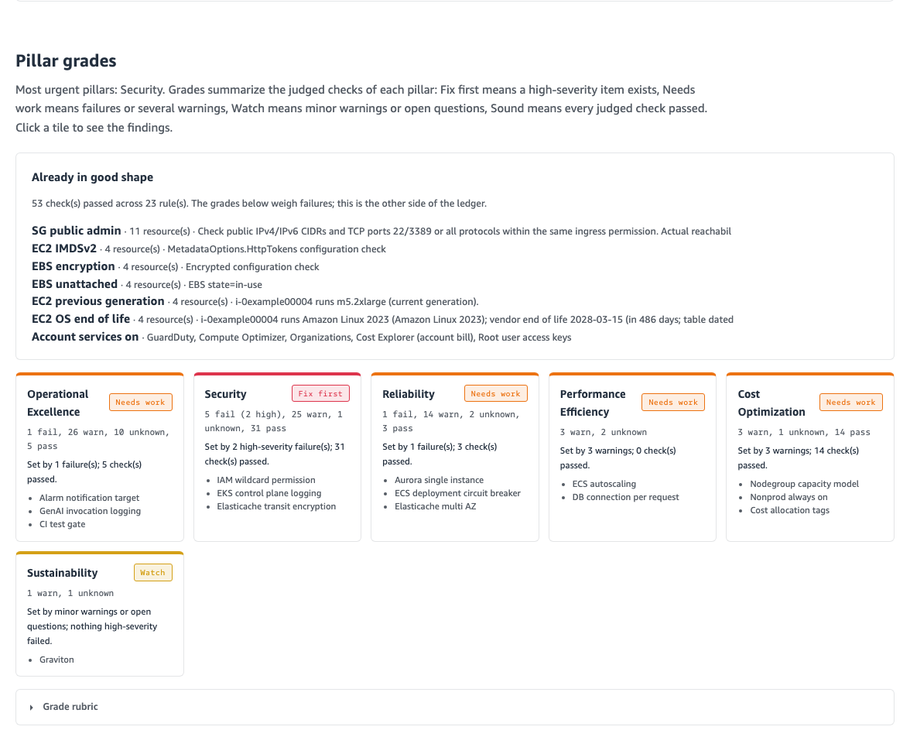
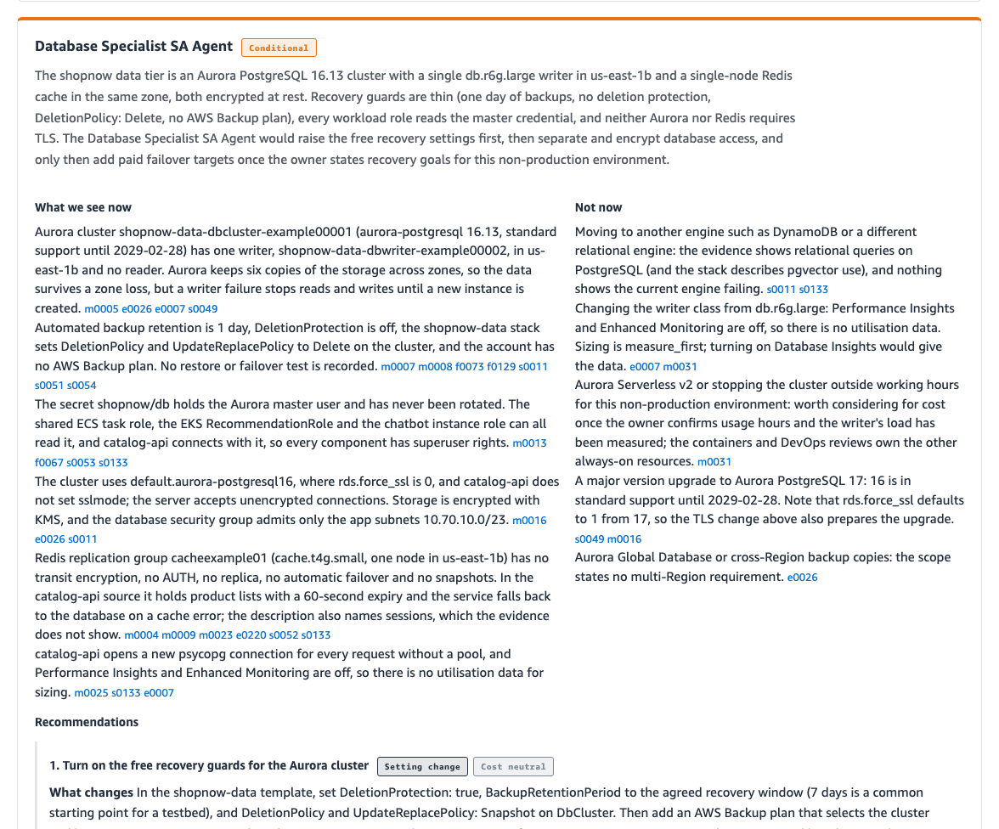
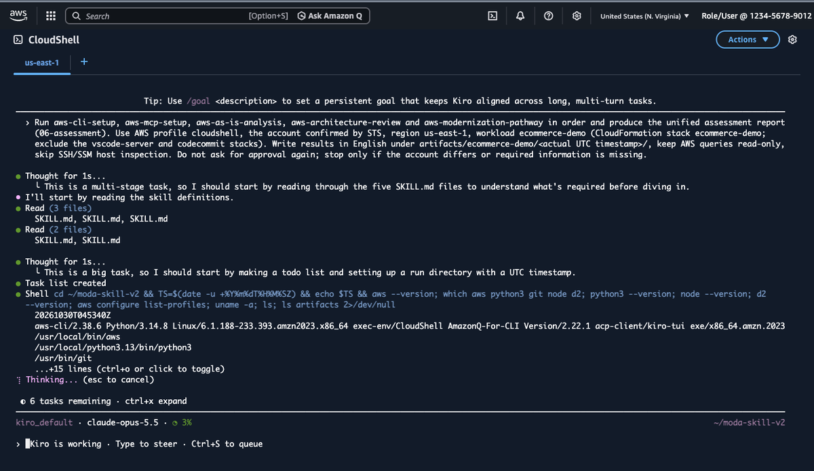

# AWS Modernization Assessment Skills

**English** · [한국어](README.ko.md)

These agent skills run an AWS modernization assessment of one workload as a repeatable
procedure. You install them into **Kiro CLI, Claude Code or Codex**, give the agent an account
and a workload, and receive one report. The report covers the key issues in plain language, the
current architecture, qualitative grades for the six Well-Architected pillars, findings with
their evidence, security recommendations, reviews from five Specialist SA Agents (each with an
architecture diagram), a combined target architecture, and reference material.

The agent does the analysis and writes the report. Helper scripts handle the steps that have to
come out the same every time: collection, checks, grading, rendering and validation. Running a
helper on its own does not produce an assessment.

> **Sample code, not for production use.** This repository is sample code that shows one
> approach. Review it with your security, legal and compliance teams before you use it in your
> environment, and run it only against accounts you are authorized to assess. Reports are drafts
> written with AI assistance.







*The current architecture diagram. Open the image to see it full size.*

A complete demo report from the test run below is in
[docs/examples/assessment-shopnow-en.html](docs/examples/assessment-shopnow-en.html), with the account
and resource identifiers replaced. It shows every section as a reader receives it. A Korean report
from an earlier version is in [docs/examples/assessment-orders-ko.html](docs/examples/assessment-orders-ko.html).

## Why

Most modernization assessments are put together by hand. They take weeks, two reviewers working
on the same workload deliver two different reports, scores come without the evidence behind them,
and the recommendations lean toward whatever the reviewer knows best. These skills keep the
procedure fixed so that the result depends less on who runs it.

- **Each finding points to its evidence.** A finding names the resource and the raw evidence file,
  and says whether the evidence came from API configuration, a template or source declaration, or
  a measurement on the host. When something cannot be determined, it is reported as unknown; the
  helpers do not fill gaps with estimates.
- **Grades come with their reasons.** A published rule grades each pillar as Fix first, Needs
  work, Watch, Sound or Unassessed, and every grade tile shows the checks that decided it. Numeric
  scores appear only in the appendix.
- **Specialist reviews.** Five Specialist SA Agents cover Container & Serverless, Database, Data
  Analytics, GenAI and DevOps. Each is an AI agent working in the role of an AWS specialist SA: it
  reviews the workload in its area and draws the proposed change. Each recommendation names the
  affected resources, an alternative (improving the current setup is a valid one), how to roll
  the change back, and the evidence. A specialist can also recommend no change for now. A
  validator rejects advice that cites references that do not exist, or that states amounts,
  schedules or improvement percentages without a source, or uses promotional wording. Based on
  these reviews, the seven modernization directions (Container, Serverless, Managed Database,
  Managed Analytics, GenAI, Cloud Native, Modern DevOps) are rated candidate, conditional, not
  recommended or not assessed.
- **Prices come from the AWS Price List API.** Costs are published On-Demand list prices with
  the basis they were calculated on. They are not a bill forecast, and the report does not
  estimate savings, dates or person-days.
- **Read-only by default.** The helpers only read: describe, list and get calls, plus the IAM
  policy simulator and the CloudTrail event lookup. The one exception is the optional host
  inspection over SSM Run Command. Credential values never go into any output, and collection
  stops if the account STS returns differs from the one you named.

## What you get

```text
artifacts/<workload>/<UTC run id>/
  01-setup/        access-check.json                  account and permission verification
  02-toolkit/      toolkit-check.json                 MCP, renderer and tool checks
  03-as-is/        inventory.json, raw/, as-is-report.md   configuration evidence
  04-review/       findings.json, scorecard.json, review.html, diagrams/
  05-modernization/ specialists/<id>/ (advice, diagram), specialist-advice.json, pathways.json, diagrams/
  06-assessment/   assessment.html, details.html, .md  the English draft: the three-section report and its details page
  06-assessment-ko/ assessment.html, details.html       the report in the language you asked for (here Korean)
```



The unified report has these sections, in this order:

1. At a glance, a one-page summary built from the sections below
2. Key issues: the problem, why it matters, a suggestion, and the linked findings
3. Current architecture diagram (click to enlarge)
4. Account posture
5. Pillar grades
6. Findings by pillar, each pillar with its open questions
7. Security recommendations, with local checks shown next to imported
   [Service Screener](skills/aws-architecture-review/references/service-screener.md) results
8. Specialist SA Agent recommendations, each with its own architecture diagram
9. The combined target architecture and the seven directions
10. Reference material and terms
11. Evidence (collapsed), and an appendix with the method, scores and run provenance

The report is written in the language of your request, and the English draft is kept next to it.



| Grade | Rule (the first rule that matches applies) |
|---|---|
| Fix first | any high-severity FAIL |
| Needs work | any FAIL, or three or more WARN |
| Watch | one or two WARN, or any open question (UNKNOWN) |
| Sound | every judged check passed and no open question |
| Unassessed | no judged checks |

## How it works

| Stage | Skill | Produces |
|---|---|---|
| 0 | [moda-skill](skills/moda-skill/SKILL.template.md) + [aws-skills-install](skills/aws-skills-install/SKILL.md) | The `/moda-skill` entry point and its subcommands; installation into the client with hash checks; MCP configuration |
| 1 | [aws-cli-setup](skills/aws-cli-setup/SKILL.md) | Verified account and access |
| 2 | [aws-mcp-setup](skills/aws-mcp-setup/SKILL.md) | AWS Knowledge MCP, D2, rendering tools, run metadata |
| 3 | [aws-as-is-analysis](skills/aws-as-is-analysis/SKILL.md) | Discovery of every tagged service (Resource Groups Tagging API), inventory of the default and discovered services, account posture (Security Hub, GuardDuty, Config, Inspector, Access Analyzer, Compute Optimizer, Trusted Advisor, Health, Organizations, Cost Explorer spend by service), raw evidence, templates and source, optional SSH/SSM host inspection |
| 4 | [aws-architecture-review](skills/aws-architecture-review/SKILL.md) | Findings for the six pillars, including lifecycle checks (engine, Kubernetes, runtime and OS support dates, previous-generation instance types, Classic Load Balancers, launch configurations, commercial licenses, stack drift) and edge checks (flow logs, CloudFront, ACM); grades; current-state diagram in AWS style |
| 5 | [aws-modernization-pathway](skills/aws-modernization-pathway/SKILL.md) | Five Specialist SA Agent reviews with diagrams, the seven directions, fit for AI, observability and messaging services, the combined target diagram, and the unified report |

Each skill consists of a `SKILL.md` that the agent follows, helper scripts in `scripts/`, and
reference documents in `references/`. Every stage checks that the account and run ID match the
previous stage. Two companion skills, `aws-diagram-design` and `aws-bento-deck`, are downloaded
at [pinned commits](skills/aws-mcp-setup/assets/dependencies.lock.json) together with their
licenses.



## Tested clients

On 2026-11-15 each client ran one full assessment of the same demo workload (7 CloudFormation
stacks, 71 resources in us-east-1), at the same time and against the same account. The profile
could change the account.

| Client | Model | Run time | Report | Read-only guard |
|---|---|---|---|---|
| Kiro CLI 3.3.0 | `claude-opus-5.5`, effort high | 145 min | Final | 9 of 9 checks |
| Claude Code 2.1.309 (Amazon Bedrock) | Opus 5.5, effort xhigh | 66 min | Final | 9 of 9 checks |
| Codex CLI 0.155.1 (Amazon Bedrock) | `openai.gpt-6-astra`, effort high | 46 min | Final | 9 of 9 checks |

All three stopped at stage 1 because the profile could make changes, and continued only after the
decision was recorded. After each run the agent tried nine actions the guard must stop, such as
`create-tags --dry-run`, reading a secret, switching the profile and editing an installed skill.
The guard blocked every attempt except one read that `plan_check.py` had approved first.
Each figure comes from a single run, not a benchmark. The guides show each client's steps and
screens: [Kiro CLI](docs/guides/kiro-cli.md) · [Claude Code](docs/guides/claude-code.md) ·
[Codex](docs/guides/codex.md).

## Quick start

Install the toolkit with one command and set up a project for your client with another. After
that, you run the whole assessment with `/moda-skill` (`$moda-skill` in Codex).

Step-by-step guides for each client:
[Kiro CLI](docs/guides/kiro-cli.md) · [Claude Code](docs/guides/claude-code.md) · [Codex](docs/guides/codex.md).

### 1. Install

1. Check the prerequisites: Python 3.11 or later (`python3`; on Windows `py -3` or `python`) and
   `curl`. Node and Bun are not needed.
2. Run the installer.

   macOS, Linux, WSL or AWS CloudShell:

   ```bash
   curl -fsSL https://github.com/aws-samples/sample-modernization-assessment-skills-for-aws/releases/latest/download/install.sh | sh
   ```

   Windows, in PowerShell 5.1 or 7 (a normal window, not "Run as administrator"):

   ```powershell
   irm https://github.com/aws-samples/sample-modernization-assessment-skills-for-aws/releases/latest/download/install.ps1 | iex
   ```

3. If the installer asks you to, add `~/.local/bin` to your PATH. To keep the setting, add the
   same line to `~/.zshrc` or `~/.bashrc`. On Windows, the installer adds
   `%LOCALAPPDATA%\moda-skill\bin` to your user PATH unless you pass `-NoModifyPath`.

   ```bash
   export PATH="$HOME/.local/bin:$PATH"
   ```

4. Confirm the installation.

   ```bash
   moda-skill version     # moda-skill 2.2.1
   ```

   If `moda-skill` is not found, the installation did not complete. Check that
   `~/.local/share/moda-skill/current` (Windows: `%LOCALAPPDATA%\moda-skill\current`) exists, then
   run the installer again. When a download or checksum check fails, the installer prints the
   reason.

What the installer does:

- Downloads `moda-skill-<version>.zip` and `SHA256SUMS` from the release and verifies the checksum.
- Unpacks the release under `~/.local/share/moda-skill/versions/<version>/` (Windows:
  `%LOCALAPPDATA%\moda-skill\versions\`).
- Creates the `moda-skill` launcher: `~/.local/bin/moda-skill` on Unix, and `moda-skill.cmd` and
  `moda-skill.ps1` in `%LOCALAPPDATA%\moda-skill\bin` on Windows.
- Refuses to run as root on Unix, and warns when it runs in an elevated window on Windows.

To install offline or from another host:

- Put the zip and `SHA256SUMS` in one folder and run `sh install.sh --from moda-skill-2.2.1.zip`
  (Windows: `.\install.ps1 -From .\moda-skill-2.2.1.zip`).
- Or point the installer at a mirror that serves `VERSION`, the zip and `SHA256SUMS`:
  `MODA_SKILL_BASE_URL=https://<your host>/path sh install.sh`.

### 2. Set up a project

```bash
mkdir my-assessment && cd my-assessment
moda-skill config --harness kiro        # or claude | codex
moda-skill doctor
```

`config` copies the six stage skills and the `/moda-skill` entry skill into the client's project
skill folder (`.kiro/skills`, `.claude/skills` or `.agents/skills`), adds the AWS Knowledge MCP
server to the client's configuration, and downloads the two pinned companion skills. It changes
nothing outside the project. With `--scope user` it installs into your home directory instead.
You can run `config` again at any time; `--update` replaces an older copy that you have not
modified.

`--hooks` registers two hooks with the client (`.kiro/hooks/moda-skill.json`,
`.claude/settings.json` or `.codex/hooks.json`):

- A **read-only guard** checks every `aws` command before it runs and blocks anything that is
  not a metadata read such as describe, list or get. Data reads such as `get-secret-value` or
  `s3api get-object` are blocked as well. The guard also checks calls inside `bash -c`, `eval`,
  `xargs`, `sudo` and command substitutions, rejects inline Python, Node.js or PowerShell code
  that calls AWS, and allows `ssm send-command` only with the `AWS-RunShellScript` document that
  host inspection uses. In Kiro it also checks the built-in `use_aws` tool. With the guard in
  place, read-only access is enforced by the hook rather than left to the agent's instructions.
- A **stop gate** asks the agent to continue while a run still has unfinished stages or a draft
  report.

The guard does not see AWS tools that you add yourself, such as an AWS API MCP server. The
read-only role described in [Permissions](#permissions) is the control that holds in every case.
Each client asks you to trust project hooks once (Kiro: trust the workspace; Claude Code: accept
at session start; Codex: `/hooks`, then `t`).

The hook commands use the project folder's absolute path, so the guard keeps checking the run
after the agent changes into a subfolder. If you move the project folder, run
`moda-skill config --harness <client> --hooks` again.

When a run has a `scope.json`, the guard applies stricter rules, described in
[If the profile can change the account](#if-the-profile-can-change-the-account). All AWS calls
must use the run's profile, AWS commands that the agent runs on its own need prior approval from
`plan_check.py`, and the agent cannot edit `~/.aws`, the installed skills, the hook settings or
the files that record the run's verified access and decisions (`01-setup/access-check.json`,
`scope.json` and the approved command list).

### 3. Run

Open the client in that folder. The clients differ in a few steps:

| | Kiro CLI | Claude Code | Codex |
|---|---|---|---|
| Open | `kiro-cli chat` | `claude` | `codex` |
| Trust the project hooks | Trust the workspace when asked | Trust the folder when asked; check with `/hooks` | Trust the folder, then review the hooks and press `t` |
| Turn off per-command prompts | `/tools trust-all` | `--dangerously-skip-permissions` | `-a never`, plus `-s danger-full-access` so the commands can reach AWS |
| Model and effort | `/model`; effort in the settings panel | `/model`; `--effort high` | `-m <model> -c model_reasoning_effort=high` |
| Start | `/moda-skill start ...` | `/moda-skill start ...` | `$moda-skill start ...` |

A run makes several hundred tool calls, which is why the table turns the prompts off. The hooks
still check every shell command and file edit. Then enter:

> A folder created by unzipping the release or cloning this repository contains only the two
> bootstrap skills (`moda-skill` and `aws-skills-install`). `/moda-skill start` first checks for the
> five stage skills. If they are missing, it stops and tells you what to do: run
> `moda-skill config --harness <client>` in that folder (step 2), restart the client, and start
> again. Do not use older copies under `~/.kiro/skills` as a workaround. Installed project skills
> take precedence, and old global copies only confuse the agent.

```text
/moda-skill start profile assessment region us-east-1 workload shopnow tag Project=shopnow lang ko
```

The entry skill verifies the account, confirms the scope with you in one numbered message
(without asking again for anything you already gave), runs the five stages and writes the unified
report. The other subcommands:

| Command | What it does |
|---|---|
| `/moda-skill` | Shows the current run and the next step |
| `/moda-skill prepare` | Installs or checks the skills, the MCP server and the companion skills from inside the client |
| `/moda-skill start [opts]` | `profile <p> region <r> account <12 digits> workload <n> stack <s> \| tag K=V \| account-wide ssm <i-...> \| no-ssm lang ko\|en use defaults` |
| `/moda-skill status` / `resume` | Shows progress by stage / continues from the first incomplete stage |
| `/moda-skill report` | Renders `06-assessment` again for the latest run |
| `/moda-skill doctor` / `version` / `help` | Runs the checks / shows the installed version / shows this table |

In Codex, use the `$` prefix: `$moda-skill start ...`. Plain-language requests also work
("prepare moda-skill", "start the assessment", "평가 시작해").

To manage versions, use `moda-skill list`, `moda-skill use <version>`, `moda-skill rollback` and
`moda-skill uninstall --yes`. Uninstalling leaves the project skills in place.

### Without the installer

Clone this repository with `git clone` and open your client in it. The `.kiro/skills`,
`.claude/skills` and `.agents/skills` folders already contain the rendered `moda-skill` entry
skill and the installer skill, so `/moda-skill prepare` works from the first prompt. You need
Python 3.11 or later, AWS CLI v2, Git, Node.js 18 or later (for PNG export) and, optionally,
[D2](https://d2lang.com). Sign in with an SSO profile or temporary credentials; see
[aws-cli-setup](skills/aws-cli-setup/SKILL.md). For CloudShell, including an `assessment`
profile that refreshes its own credentials, see [docs/CLOUDSHELL.md](docs/CLOUDSHELL.md).

### Recommended model

The assessment was designed and tested with the newest frontier model, currently
**Claude Opus 5.5** (`claude-opus-5.5`), at effort `high` or above. With Sonnet-class models the
key issues and recommendations are noticeably shallower and diagrams need more retries.
Haiku-class models skip steps and are suitable only for checking that the tooling runs.
`/moda-skill start` checks the session's model and effort first and stops with a short message
when they are below the recommended level; `/moda-skill doctor` reports the same check. The
report's provenance section records the model, and a report made with a weaker model says so.
Choose the model with `/model` (Kiro, Claude Code) or `-m` (Codex). In Kiro CLI, also check the
effort set for the model in `~/.kiro/settings/cli.json`
(`chat.modelDefaults.<model>.output_config.effort`). The model tiers are listed in
[skills/moda-skill/assets/models.json](skills/moda-skill/assets/models.json). Codex was tested with
`openai.gpt-6-astra` at effort high. OpenAI models are not in the model guidance, so
`$moda-skill start` asks you to confirm before it continues; the test run still produced a Final
report.

### Useful follow-up prompts

> Import the Service Screener result at `<path>/api-full.json` read-only and show it beside the
> local checks in the security chapter, then regenerate 06-assessment.

> Inspect instances `<i-...>` through SSM (inspect_host.py --execute). Do not collect source
> bodies, environment variable values, logs or database data.

> Write the report in Korean. *(Any language works; the English draft stays in `06-assessment/`.)*

## Permissions

The helpers only read from AWS, so a single role that can read every resource is enough. Create a dedicated role (for example `ModernizationAssessmentRole`, trusted by your
account) and attach two policies:

1. The AWS managed policy **`ReadOnlyAccess`** (type "AWS managed - job function"). It covers
   every service the skills query, including `cloudformation:GetTemplate` and
   `codecommit:GetFile`, which `ViewOnlyAccess` does not include.
2. [`docs/iam/assessment-policy.json`](docs/iam/assessment-policy.json) as an inline policy. It
   explicitly denies data reads that `ReadOnlyAccess` would otherwise allow (`s3:GetObject`,
   `secretsmanager:GetSecretValue`, `dynamodb:Scan`, `logs:GetLogEvents`, `lambda:GetFunction`).
   The skills never make those calls, and the Deny means the role cannot make them either. The
   policy also allows the one write the skills can perform: SSM Run Command for the optional host
   inspection, limited to the `AWS-RunShellScript` document and the instances you inspect. For
   each engagement, replace `REGION`, `ACCOUNT_ID` and `INSTANCE_ID` in the
   `HostInspectionRunShellScriptOnNamedInstances` statement (one instance ARN per host), or
   delete the statement if you do not use host inspection.

In CloudShell, point a profile at that role. The container credential provider supplies and
refreshes the source credentials, so no key is written to disk:

```bash
ACCOUNT=$(aws sts get-caller-identity --query Account --output text)
aws configure set role_arn arn:aws:iam::$ACCOUNT:role/ModernizationAssessmentRole --profile assessment
aws configure set credential_source EcsContainer --profile assessment
aws configure set region us-east-1 --profile assessment
aws --profile assessment sts get-caller-identity     # Arn ends in assumed-role/ModernizationAssessmentRole/...
```

Then tell the agent to use `profile assessment`. Host inspection also needs the SSM Agent and an
instance profile with `AmazonSSMManagedInstanceCore` on the instances you inspect. To limit it to
specific instances, set the `Resource` of `HostInspectionViaSsm` to the `AWS-RunShellScript`
document ARN and those instance ARNs.

A denied call does not stop the run. The collector records `access_denied`, the related checks
become UNKNOWN, and the report notes it. An account mismatch is different: the run stops when
the account returned by STS differs from the one you named. Credentials are never written to any output, and when you use a
profile, static keys are removed from the environment of the helpers.

**Where the collected data goes.** The helpers store everything under `artifacts/` on the machine
that runs them. The agent reads this evidence to write the report, so it is sent to the model
provider of the agent you use (Kiro CLI, Claude Code or Codex). Use an agent that your
organization has approved for this account's metadata. Files under `artifacts/` contain
identifiers in clear (account ID, ARNs, IAM user names). The report also shows the account ID and
resource ARNs, and masks only IAM user names. Treat the folder and the report as confidential data
of the account owner, and delete the folder when the engagement ends.

### If the profile can change the account

Whenever you can, use the read-only role above. It is the only control that holds regardless of
what the agent does. If the profile can still change the account, for example an administrator
role or an IAM user's access keys, the toolkit adds the following checks. All of them use
read-only calls.

1. **Stage 1 checks the profile first.** After the STS check, `verify_access.py` uses the IAM
   policy simulator (`iam simulate-principal-policy`, and `iam get-role` for a role session) to
   test 20 representative changes, data reads and credential operations. It records the principal
   type and the result as `write_capability` (`yes`, `no` or `unknown`) in
   `01-setup/access-check.json`. For `yes` or `unknown`, the agent pauses and offers three
   options: switch to a read-only profile, stop, or continue with this profile. The agent never
   creates or changes IAM resources. The simulator does not evaluate organization SCPs or resource
   policies; those can only deny more, so a `no` result is reliable.
2. **The collecting helpers do not start** (`collect.py`, `supplement.py`,
   `inspect_host.py --execute`) until the person's decision to continue is recorded in
   `scope.json` (`write_capable_acknowledged`). They also do not start when a skill file differs
   from the install manifest.
3. **The guard holds the run to its profile.** Every AWS call must use the run's profile. The
   guard rejects environment variables that switch credentials, profile files or the endpoint, and
   rejects changes to the run profile's `role_arn`, `source_profile` or SSO settings. AWS commands
   that the agent runs outside the helpers must first be listed in `RUN_DIR/agent-commands.json`
   and approved by `plan_check.py`. It approves only plain read commands on the run's profile and
   regions, and rejects options that change the endpoint or TLS checks, print request details, or
   read local files. The guard then allows exactly the approved commands.
4. **CloudTrail is checked at the end.** `write_audit.py` uses `cloudtrail lookup-events` to list
   management events with `ReadOnly=false` made by the run's principal during the run, in every
   region in scope and in us-east-1. The report shows the result under Method and provenance: no
   change, the changes found, or the regions it could not read. Each change names the tool that
   made it, because other work done with the same principal during the run, such as a deployment
   from another session, appears too. CloudTrail can take up to 15 minutes to show an event, and
   data events are not included.

The [test runs](#tested-clients) went through these checks in all three clients.

## Limits

- Grades, scores and direction ratings follow this toolkit's own deterministic rules, documented
  in the [review method](skills/aws-architecture-review/references/review-method.md#qualitative-grades).
  They are not AWS Well-Architected Tool results or a security certification.
- The agent writes the key issues and the Specialist SA Agent recommendations. The helpers confirm that cited references exist and
  reject made-up amounts, schedules and promotional wording, but they cannot prove that the advice
  is right.
- The scope is the workload you name. Application logic and database contents are not inspected.
- Costs are published On-Demand list prices with their basis, not a bill forecast. Savings, dates
  and effort in person-days are not estimated.
- Model usage is read from the client's own session records (Kiro CLI, Claude Code, Codex). When
  the records cover only part of the run, the report says so instead of showing a misleading
  number.

## Verification

```bash
python3 -m unittest discover -s tests                              # unit tests (no AWS access)
python3 scripts/validate_bundle.py                                 # SKILL.md front matter, references, assets
python3 skills/aws-skills-install/scripts/build_manifest.py --check   # install manifest matches sources
```

The two copies of `report_kit.py` must stay identical byte for byte, and a test checks this.
Validation history is in [docs/VALIDATION.md](docs/VALIDATION.md); upstream sources and pinned
versions are in [docs/SOURCES.md](docs/SOURCES.md).

## Contributing

See [CONTRIBUTING.md](CONTRIBUTING.md). After you change anything under `skills/`, rebuild the
manifest (`python3 skills/aws-skills-install/scripts/build_manifest.py`) and run the three checks
above. Skill definitions and the canonical report drafts are written in English. Reports in other
languages are produced with `localize_artifacts.py` and the glossary; the skill text itself is not
translated.

## Security

To report a security issue, follow [CONTRIBUTING.md](CONTRIBUTING.md#security-issue-notifications).
Please do not open a public issue for a vulnerability.

## License

This project is licensed under the MIT-0 License; see [LICENSE](LICENSE). The companion skills are
downloaded at pinned commits under their own licenses. Those licenses are recorded in
[dependencies.lock.json](skills/aws-mcp-setup/assets/dependencies.lock.json) and copied next to
each installed companion skill as `UPSTREAM-LICENSE`.
