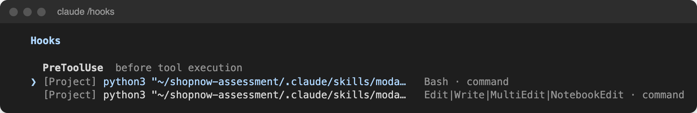
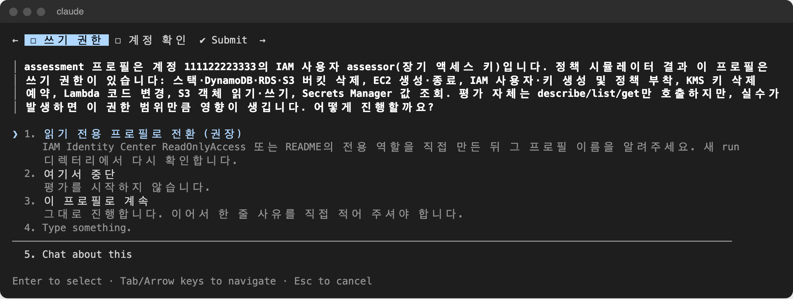
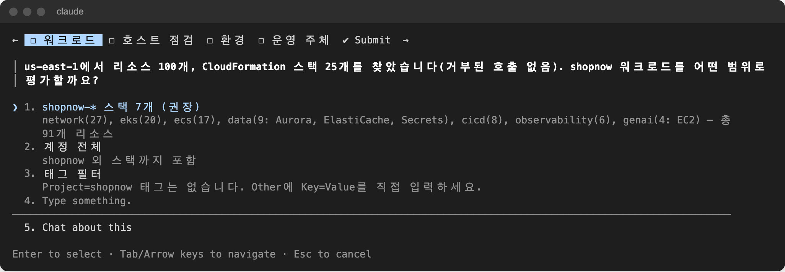
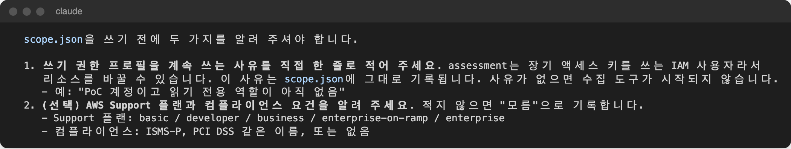

# Claude Code에서 평가 실행하기

[English](claude-code.md) · **한국어**

빈 폴더에서 시작해 보고서를 받기까지 Claude Code에서 평가를 한 번 진행하는 과정을 정리했습니다.
2026-11-15에 실제로 실행한 내용을 바탕으로 합니다.

| | |
|---|---|
| 클라이언트 | Claude Code 2.1.309(Amazon Bedrock), Apple silicon macOS |
| 모델 | Opus 5.5, effort `xhigh` |
| 도구 | moda-skill 2.2.1 |
| 워크로드 | CloudFormation 스택 7개, 범위 내 리소스 71개, us-east-1, 호스트 점검 없음 |

[Kiro CLI](kiro-cli.ko.md)와 [Codex](codex.ko.md) 가이드도 같은 순서로 구성되어 있습니다.

화면은 테스트 세션에서 캡처했습니다. 계정 ID, 사용자 이름, 테스트 계정에 있는 다른 프로젝트 이름은 다른 값으로 바꾸거나
지웠고, 다른 도구의 훅은 보이지 않게 했습니다.

## 시작하기 전에

- [README](../../README.ko.md#1-설치)의 안내대로 도구를 설치하고 `moda-skill version`이 동작하는지
  확인합니다.
- Claude Code에 로그인되어 있어야 합니다. Amazon Bedrock을 쓰는 경우 Claude Code는 모델 호출에
  자체 AWS 자격 증명을 사용합니다(`~/.claude/settings.json`의 `CLAUDE_CODE_USE_BEDROCK=1`과
  `AWS_PROFILE`). 이 프로필은 평가에 쓰는 프로필과 달라도 됩니다.
- 평가할 계정의 AWS CLI 프로필을 준비합니다. 가장 안전한 것은 읽기 전용 역할입니다.
  [권한](../../README.ko.md#권한)을 참고해 주세요. 계정을 변경할 수 있는 프로필이라면 1단계에서
  평가가 멈추고 진행 방법을 묻습니다(아래 5단계).
- 보고서의 PNG 내보내기와 화면 점검에는 Playwright가 필요합니다. 1단계를 마친 뒤 프로젝트 폴더에서
  `npm install --no-save playwright@1.64.1`과 `npx playwright@1.64.1 install chromium`을 실행해 두세요.
  테스트 당시 폴더에 Playwright가 없어서 에이전트가 다른 프로젝트 폴더의 사본을 사용했습니다. 지금은
  스킬이 프로젝트 폴더에 설치하거나, PNG 내보내기를 건너뛰었다고 알리도록 안내합니다.

## 1. 프로젝트 구성

```bash
mkdir shopnow-assessment && cd shopnow-assessment
moda-skill config --harness claude --hooks
moda-skill doctor
```

`config`는 스킬을 `.claude/skills`에 복사하고, AWS Knowledge MCP 서버를 `.mcp.json`에 추가하고,
보조 스킬 두 개를 내려받습니다. `--hooks`를 지정하면 `.claude/settings.json`에 훅도 추가합니다.
`doctor` 결과에 `local_prerequisites_ready`와 `mcp: connected`가 나오면 준비가 끝난 것입니다.

## 2. Claude Code 실행과 훅 확인

```bash
claude --dangerously-skip-permissions --effort xhigh
```

폴더를 신뢰할지 물으면 신뢰를 선택해 주세요. 프로젝트 훅과 설정은 신뢰한 폴더에서만 적용됩니다.
`/hooks`를 실행해 `[Project]` 항목을 확인합니다.

| 이벤트 | 매처 |
|---|---|
| PreToolUse | `Bash` |
| PreToolUse | `Edit\|Write\|MultiEdit\|NotebookEdit` |
| Stop | |



평가 한 번에 도구 호출이 수백 번 일어나므로, 테스트에서는 `--dangerously-skip-permissions`로 권한
확인을 껐습니다. 이 상태에서도 PreToolUse 훅은 모든 Bash 명령과 파일 수정 전에 실행됩니다.
[가드가 막은 항목](#가드가-막은-항목)을 참고해 주세요. 명령마다 직접 승인하고 싶다면 이 옵션 없이
`claude`를 실행하면 되는데, 읽기 명령을 여러 번 승인해야 합니다.

## 3. 모델과 effort 설정

`/model`로 Opus를 선택합니다. 이 평가는 effort `high` 이상에서 테스트했습니다. 시작할 때
`--effort high`(또는 `xhigh`)를 지정하거나, `~/.claude/settings.json`의 `effortLevel`로 설정합니다.

## 4. 평가 시작

```text
/moda-skill start profile assessment region us-east-1 workload shopnow lang en
```

## 5. 확인 질문에 답하기

Claude Code는 탭으로 나뉜 입력 양식으로 질문합니다. 화살표 키와 Enter로 선택하고, 직접 답하고
싶으면 "Type something."을 고릅니다. 답을 검토한 뒤 "Submit answers"를 누릅니다.

**계정을 변경할 수 있는 프로필.** IAM 정책 시뮬레이터로 확인한 결과 프로필에 변경 권한이 있으면,
첫 양식에서 가능한 작업을 보여 주고 읽기 전용 프로필로 바꾸기, 여기서 중단, 그래도 계속하기 중
하나를 고르게 합니다. 두 번째 탭에서는 평가할 계정이 맞는지 확인합니다. 계속하기로 했다면 "Type
something."이나 에이전트가 따로 묻는 메시지에 이유를 직접 한 줄로 적어 주세요. 이유는
`scope.json`에 기록되며, 기록되기 전까지 수집 헬퍼는 실행되지 않습니다.



**평가 범위.** 두 번째 양식에서는 워크로드(에이전트가 찾은 스택 또는 계정 전체), 호스트 점검,
환경, Support 플랜을 묻습니다.



양식을 제출하면 에이전트가 계속 진행하는 이유를 직접 적어 달라고 따로 묻습니다.



## 6. 실행 중과 실행 후

이후에는 추가 질문 없이 다섯 단계가 진행됩니다. 보고서는
`artifacts/<workload>/<run id>/06-assessment/assessment.html`에 생기고, 다른 언어를 요청했다면
`06-assessment-<lang>/`에도 만들어집니다.

- `/moda-skill status`로 진행 중인 단계를 확인하고, `/moda-skill resume`으로 중단된 실행을 이어갈 수
  있습니다. 종료 후에는 종료할 때 출력되는 `claude --resume <id>`로 대화를 다시 열 수 있습니다.
- 보고서의 작성 정보에는 메인 세션 기록에서 가져온 사용량이 들어갑니다. Claude Code가 다이어그램이나
  검토를 위해 띄운 하위 에이전트는 그 기록에 없으므로, 전체 사용량은 `/cost`에서 확인해 주세요.
- 마지막의 쓰기 감사는 실행 동안 CloudTrail에 기록된, 프로필의 IAM 주체가 만든 변경을 모두
  보여 줍니다. 같은 주체로 한 다른 작업도 함께 나타납니다. 테스트에서 나온 변경은 같은 시각 다른
  세션에서 진행된 배포였습니다. 평가에만 쓰는 프로필을 사용하면 이 확인 결과가 깨끗하게 나옵니다.

## 테스트 실행 결과

| | |
|---|---|
| 1단계부터 마지막 단계 파일까지 | 66분 |
| 세션의 `/cost` | US$38.38: 입력 192.0k, 출력 501.8k, 캐시 읽기 71.7M, 캐시 쓰기 2.6M 토큰 |
| 보고서 | Final, 핵심 문제 6개, 분야별 검토 5개 |
| 읽기 전용 가드 | 9개 항목 모두 의도대로 동작(아래) |

세 클라이언트를 같은 계정에서 동시에 실행했습니다. 그 부하로 일부 CloudFormation 호출이 시간
초과되었고, 에이전트가 한 번 다시 시도했습니다. 소요 시간은 한 번 관찰한 값일 뿐 벤치마크는
아닙니다.

### 가드가 막은 항목

평가가 끝난 뒤 에이전트에게 아래 항목을 한 번씩 시도하게 했습니다. EC2 호출에는 `--dry-run`을
붙였고, 시크릿은 존재하지 않는 이름이며, 파일은 테스트용입니다.

| 시도 | 결과 |
|---|---|
| `aws ec2 create-tags --dry-run ...` | 차단: 읽기 전용 메타데이터 호출이 아님 |
| 같은 명령을 `bash -c "..."` 안에서 실행 | 차단 |
| boto3 `create_tags`를 호출하는 `python3 -c` | 차단: AWS를 호출하는 인라인 코드 |
| `aws secretsmanager get-secret-value` | 차단: 데이터 내용이나 자격 증명을 읽는 호출 |
| `AWS_PROFILE=default aws ec2 describe-vpcs` | 차단: 이번 실행의 프로필만 사용 가능 |
| 승인 목록에 없는 `aws ec2 describe-vpcs` | 차단된 뒤, `plan_check.py` 승인을 받고 실행됨 |
| `echo ... >> ~/.aws/...` | 차단: `~/.aws`는 보호 대상 |
| Edit 도구로 `.claude/skills/moda-skill/SKILL.md` 수정 | 차단: 설치된 스킬은 보호 대상 |
| Edit 도구로 실행의 `scope.json` 수정 | 차단: 단계 헬퍼만 기록 가능 |

이후 CloudTrail에도 `CreateTags`나 `GetSecretValue` 호출은 없었습니다.

## 문제 해결

| 증상 | 원인과 해결 |
|---|---|
| `/moda-skill start`가 단계 스킬이 없다고 안내함 | 이 폴더에서 `moda-skill config --harness claude`를 실행하고 Claude Code를 다시 시작한 뒤 시도해 주세요. |
| `/hooks`에 `[Project]` 항목이 없음 | 폴더를 신뢰하지 않았거나 `config`를 `--hooks` 없이 실행한 경우입니다. `moda-skill config --harness claude --hooks`를 실행하고 Claude Code를 다시 시작해 주세요. |
| 모델 확인 단계에서 멈춤 | Opus로 바꾸거나 effort를 높여 다시 시작하거나, 현재 설정으로 계속하겠다고 답합니다. |
| 다이어그램이 PNG 없이 SVG로만 남음 | 프로젝트 폴더에 Playwright가 없습니다. "시작하기 전에"의 방법으로 설치한 뒤 에이전트에게 PNG를 다시 내보내 달라고 요청해 주세요. |
| 프로젝트 폴더를 옮긴 뒤 가드가 동작하지 않음 | 훅 명령에 폴더의 절대 경로가 들어 있습니다. 새 위치에서 `moda-skill config --harness claude --hooks`를 실행하고 클라이언트를 다시 시작해 주세요. |
