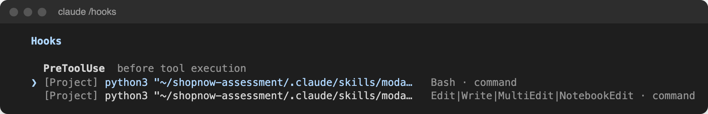
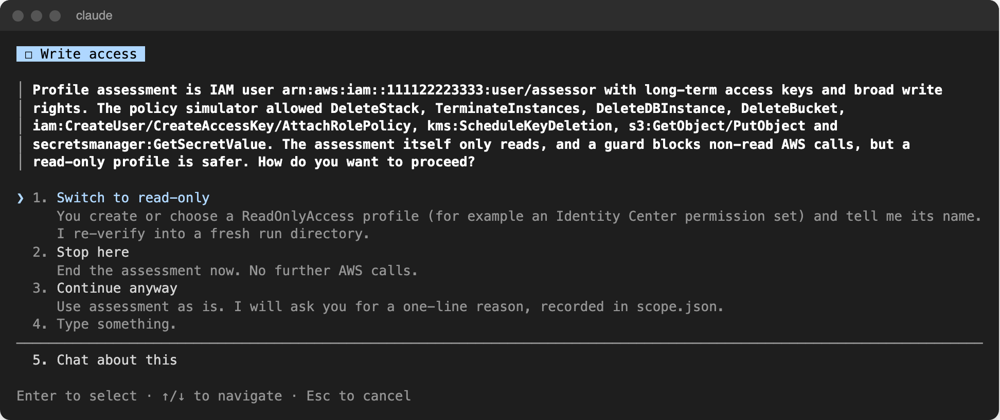
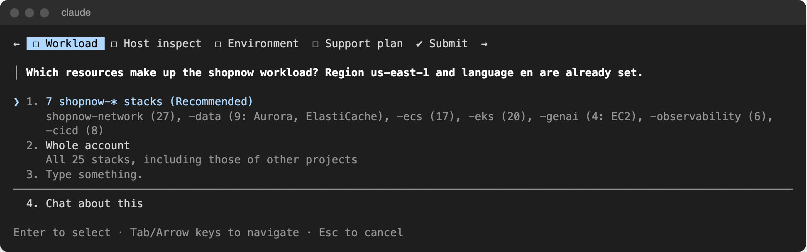

# Running the assessment in Claude Code

**English** · [한국어](claude-code.ko.md)

This guide walks through one assessment in Claude Code, from an empty folder to the report. It is
based on a test run on 2026-11-15:

| | |
|---|---|
| Client | Claude Code 2.1.309 with Amazon Bedrock, macOS on Apple silicon |
| Model | Opus 5.5, effort `xhigh` |
| Toolkit | moda-skill 2.2.1 |
| Workload | 7 CloudFormation stacks, 71 resources in scope, us-east-1, no host inspection |

The guides for [Kiro CLI](kiro-cli.md) and [Codex](codex.md) follow the same steps.

Screenshots are from the test sessions. The account ID, the user name and the names of other
projects in the test account are replaced or removed, and hooks of other tools are hidden.

## Before you start

- Install the toolkit as described in the [README](../../README.md#1-install) and check that
  `moda-skill version` works.
- Sign in to Claude Code. With Amazon Bedrock, Claude Code uses its own AWS credentials for the
  model (`CLAUDE_CODE_USE_BEDROCK=1` and `AWS_PROFILE` in `~/.claude/settings.json`). That profile
  can differ from the one you assess with.
- Have an AWS CLI profile for the account. A read-only role is the safest choice; see
  [Permissions](../../README.md#permissions). If the profile can change the account, the
  assessment stops at stage 1 and asks how to proceed (step 5 below).
- For PNG export and visual checks of the report, install Playwright in the project folder after
  step 1: `npm install --no-save playwright@1.64.1` and `npx playwright@1.64.1 install chromium`.
  In the test run the folder had no Playwright, and the agent used the copy in another project
  folder; the skill now tells the agent to install it in the project folder or report that PNG
  export was skipped.

## 1. Set up the project

```bash
mkdir shopnow-assessment && cd shopnow-assessment
moda-skill config --harness claude --hooks
moda-skill doctor
```

`config` copies the skills into `.claude/skills`, adds the AWS Knowledge MCP server to `.mcp.json`,
downloads the two companion skills and, with `--hooks`, adds the hooks to
`.claude/settings.json`. `doctor` should report `local_prerequisites_ready` and
`mcp: connected`.

## 2. Start Claude Code and check the hooks

```bash
claude --dangerously-skip-permissions --effort xhigh
```

If Claude Code asks whether you trust the folder, accept it; project hooks and settings load only
in a trusted folder. Run `/hooks` and check the `[Project]` entries:

| Event | Matcher |
|---|---|
| PreToolUse | `Bash` |
| PreToolUse | `Edit\|Write\|MultiEdit\|NotebookEdit` |
| Stop | |



The run makes several hundred tool calls, so the test run turned off permission prompts with
`--dangerously-skip-permissions`. The PreToolUse hooks still run before every Bash command and
file edit; see [What the guard blocked](#what-the-guard-blocked). If you prefer to approve each
command, start `claude` without the flag and expect to confirm many read commands.

## 3. Set the model and effort

Choose Opus with `/model`. The assessment is tested at effort `high` or above; set it with
`--effort high` (or `xhigh`) at start, or with `effortLevel` in `~/.claude/settings.json`.

## 4. Start the assessment

```text
/moda-skill start profile assessment region us-east-1 workload shopnow lang en
```

## 5. Answer the checks

Claude Code asks its questions in a form with tabs. Choose an option with the arrow keys and
Enter; "Type something." lets you answer in your own words. Review the answers and press
"Submit answers".

**Write-capable profile.** When the IAM policy simulator shows that the profile can make changes,
the first form lists what it can do and offers: switch to a read-only profile, stop here, or
continue anyway. A second tab asks you to confirm the account. If you continue, give a one-line
reason in your own words, either with "Type something." or when the agent asks for it. The reason
is stored in `scope.json`, and the collecting helpers do not start until it is there.



**Scope.** The second form asks for the workload (the stacks the agent found, or the whole
account), host inspection, the environment and the support plan.



## 6. While it runs, and after

The agent runs the five stages without further questions. The report is in
`artifacts/<workload>/<run id>/06-assessment/assessment.html` (three sections: current architecture, Well-Architected review, Specialist SA Agent
recommendations; every finding and the evidence are in `details.html` beside it), and a localized copy in
`06-assessment-<lang>/` when you ask for another language.

- `/moda-skill status` shows the stage the run is in; `/moda-skill resume` continues an
  interrupted run. After you quit, `claude --resume <id>` (printed on exit) reopens the
  conversation.
- The report's provenance section imports usage from the session transcript and from the
  transcripts of the sub-agents Claude Code started for diagrams and reviews. In the test run the
  sub-agents used more than half of the tokens. `/cost` shows the client's own total and price.
- The write audit at the end lists every change CloudTrail recorded for the profile's IAM
  principal during the run. Other work done with the same principal shows up there too; in the
  test run the changes it found came from a deployment running in another session. A profile used
  only for the assessment keeps this check clear.

## What one test run looked like

| | |
|---|---|
| Stage 1 to the last stage file | 66 minutes |
| `/cost` for the session | US$38.38: 192.0k input, 501.8k output, 71.7M cache read and 2.6M cache write tokens |
| Report | Final, 6 key issues, 5 specialist reviews |
| Read-only guard | 9 of 9 checks behaved as expected (below) |

Three clients ran against the same account at the same time. Some CloudFormation calls timed out
under that load, and the agent retried them once. The times are one observation, not a
benchmark.

### What the guard blocked

After the run, the agent was asked to try each of the following once. The EC2 calls used
`--dry-run`, the secret did not exist, and the files were test files.

| Attempt | Result |
|---|---|
| `aws ec2 create-tags --dry-run ...` | blocked: not a read-only metadata call |
| The same inside `bash -c "..."` | blocked |
| `python3 -c` with boto3 `create_tags` | blocked: inline code that calls AWS |
| `aws secretsmanager get-secret-value` | blocked: reads data content or credentials |
| `AWS_PROFILE=default aws ec2 describe-vpcs` | blocked: the profile must stay the run's profile |
| `aws ec2 describe-vpcs` not in the approved list | blocked, then ran after `plan_check.py` approved it |
| `echo ... >> ~/.aws/...` | blocked: `~/.aws` is protected |
| Edit tool on `.claude/skills/moda-skill/SKILL.md` | blocked: installed skills are protected |
| Edit tool on the run's `scope.json` | blocked: only the stage helpers write it |

CloudTrail showed no `CreateTags` or `GetSecretValue` call afterwards.

## Troubleshooting

| Symptom | Cause and fix |
|---|---|
| `/moda-skill start` says the stage skills are missing | Run `moda-skill config --harness claude` in this folder, restart Claude Code and start again. |
| `/hooks` shows no `[Project]` entries | The folder is not trusted, or `config` ran without `--hooks`. Run `moda-skill config --harness claude --hooks` and restart Claude Code. |
| The model check stops the run | Switch to Opus or raise the effort and start again, or reply that you want to continue anyway. |
| Diagrams are left as SVG without PNG | Playwright is not installed in the project folder. Install it as in "Before you start" and ask the agent to export the PNG files again. |
| The guard stops checking after you moved the project folder | The hook commands contain the folder's absolute path. Run `moda-skill config --harness claude --hooks` in the new location and restart the client. |
