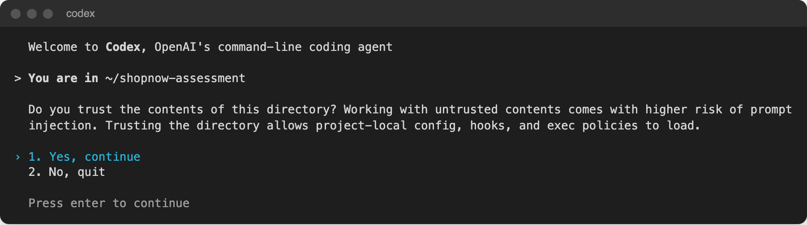
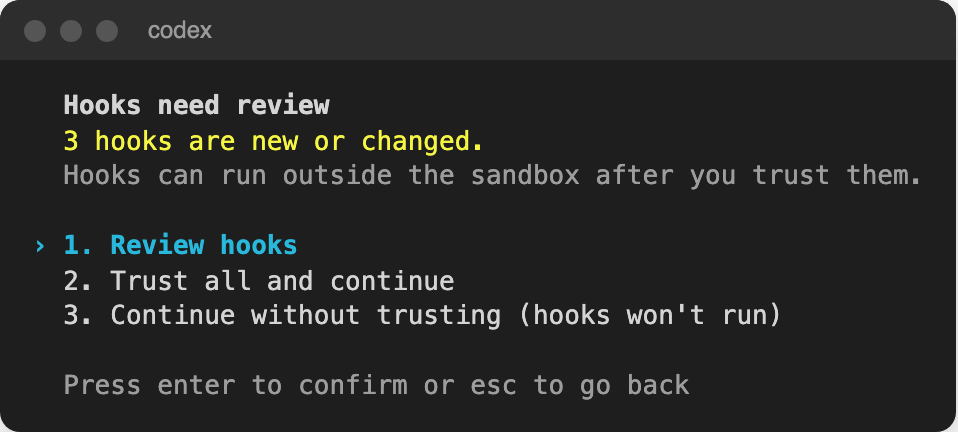
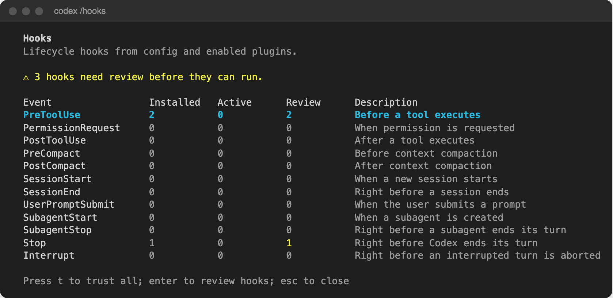
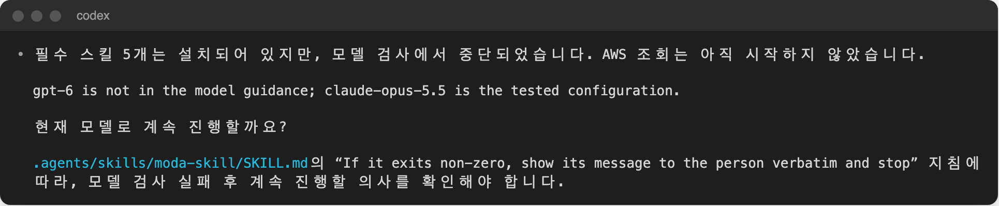
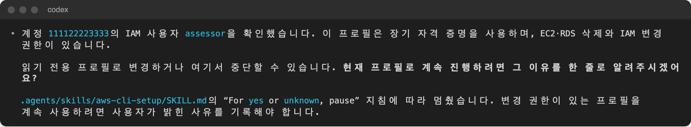
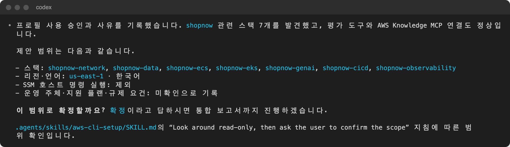

# Codex에서 평가 실행하기

[English](codex.md) · **한국어**

빈 폴더에서 시작해 보고서를 받기까지 Codex CLI에서 평가를 한 번 진행하는 과정을 정리했습니다.
2026-11-15에 실제로 실행한 내용을 바탕으로 합니다.

| | |
|---|---|
| 클라이언트 | Codex CLI 0.155.1(Amazon Bedrock 공급자), Apple silicon macOS |
| 모델 | `openai.gpt-6-astra`, reasoning effort `high` |
| 도구 | moda-skill 2.2.1 |
| 워크로드 | CloudFormation 스택 7개, 범위 내 리소스 71개, us-east-1, 호스트 점검 없음 |

[Kiro CLI](kiro-cli.ko.md)와 [Claude Code](claude-code.ko.md) 가이드도 같은 순서로 구성되어
있습니다.

화면은 테스트 세션에서 캡처했습니다. 계정 ID, 사용자 이름, 테스트 계정에 있는 다른 프로젝트 이름은 다른 값으로 바꾸거나
지웠고, 다른 도구의 훅은 보이지 않게 했습니다.

## 시작하기 전에

- [README](../../README.ko.md#1-설치)의 안내대로 도구를 설치하고 `moda-skill version`이 동작하는지
  확인합니다.
- Codex에 로그인하거나, 사용하는 모델 공급자를 설정해 둡니다.
- 평가할 계정의 AWS CLI 프로필을 준비합니다. 가장 안전한 것은 읽기 전용 역할입니다.
  [권한](../../README.ko.md#권한)을 참고해 주세요. 계정을 변경할 수 있는 프로필이라면 1단계에서
  평가가 멈추고 진행 방법을 묻습니다(아래 5단계).
- 보고서의 PNG 내보내기와 화면 점검에는 Playwright가 필요합니다. 1단계를 마친 뒤 프로젝트 폴더에서
  `npm install --no-save playwright@1.64.1`과 `npx playwright@1.64.1 install chromium`을 실행해 두세요.
  설치하지 않으면 에이전트가 필요할 때 설치하거나, PNG 내보내기를 건너뛰었다고 알려 줍니다.

## 1. 프로젝트 구성

```bash
mkdir shopnow-assessment && cd shopnow-assessment
moda-skill config --harness codex --hooks
moda-skill doctor
```

`config`는 스킬을 `.agents/skills`에 복사하고, AWS Knowledge MCP 서버를 추가하고, 보조 스킬 두 개를
내려받습니다. `--hooks`를 지정하면 `.codex/hooks.json`도 만듭니다. `doctor` 결과에
`local_prerequisites_ready`와 `mcp: connected`가 나오면 준비가 끝난 것입니다.

## 2. Codex 실행과 훅 신뢰

```bash
codex -m openai.gpt-6-astra -c model_reasoning_effort=high -a never -s danger-full-access
```

폴더에서 처음 실행하면 두 가지를 묻습니다.

1. "Do you trust the contents of this directory?" **1. Yes, continue**를 선택합니다. Codex는
   신뢰한 폴더에서만 프로젝트 설정과 훅을 불러옵니다.

   

2. "Hooks need review. 3 hooks are new or changed." **1. Review hooks**를 선택해 표를 확인하고,
   **t**를 눌러 모두 신뢰한 뒤 Esc를 누릅니다. (**2. Trust all and continue**는 표를 보지 않고 같은
   일을 합니다.) 나중에는 `/hooks`로 같은 화면을 열 수 있습니다.

   

   

신뢰하고 나면 PreToolUse에 moda-skill 가드 두 개가 활성으로 표시됩니다. 하나는 `Bash`, 하나는
`apply_patch|Edit|Write`용입니다. Stop에는 moda-skill 진행 확인 훅이 있습니다.

명령에 넣은 옵션의 의미는 다음과 같습니다.

- `-a never`는 승인 확인을 끕니다. 평가 한 번에 도구 호출이 수백 번 일어나서 하나하나 승인하기는
  어렵습니다. 확인을 꺼도 훅은 모든 셸 명령과 파일 변경을 계속 검사합니다.
  [가드가 막은 항목](#가드가-막은-항목)을 참고해 주세요.
- `-s danger-full-access`는 명령이 네트워크에 접근할 수 있게 합니다. Codex의 기본 샌드박스인
  `workspace-write`는 네트워크 접근을 막는데, 헬퍼가 AWS를 호출하려면 네트워크가 필요합니다.
  샌드박스를 유지하고 싶다면 Codex 설정에서 이 폴더의 네트워크 접근을 허용해 주세요.
- `-c model_reasoning_effort=high`는 `~/.codex/config.toml`을 바꾸지 않고 이번 세션의 effort만
  지정합니다.

## 3. 모델 확인

`moda-skill/assets/models.json`의 모델 기준에는 Claude 모델만 있습니다. 그래서 OpenAI 모델로
`$moda-skill start`를 실행하면 기준에 없는 모델이라는 안내와 함께 멈춥니다. 현재 모델로 계속하겠다고
답해 주세요.

```text
현재 모델(openai.gpt-6-astra, effort high)로 계속 진행해 주세요.
```



이 결정은 실행 기록의 노트에 남습니다.

## 4. 평가 시작

Codex에서는 `$`로 스킬을 호출합니다.

```text
$moda-skill start profile assessment region us-east-1 workload shopnow lang ko
```

## 5. 확인 질문에 답하기

**계정을 변경할 수 있는 프로필.** IAM 정책 시뮬레이터로 확인한 결과 프로필에 변경 권한이 있으면,
에이전트가 가능한 작업을 알려 주고 읽기 전용 프로필로 바꿀지, 중단할지, 계속할지 묻습니다.
계속하려면 계정을 확인해 주고 이유를 직접 한 줄로 적어 주세요.

```text
네, 111122223333이 평가 대상 계정이 맞고 이 프로필로 계속 진행합니다. 이유: 본인 소유 PoC 계정이고 읽기 전용 가드를 설치했습니다.
```



이유는 `scope.json`에 기록되며, 기록되기 전까지 수집 헬퍼는 실행되지 않습니다.

**평가 범위.** 테스트에서 Codex는 앞선 답변을 근거로 범위를 정하고 범위 질문을 따로 하지
않았습니다. 환경과 운영 주체도 이유 문구에서 추정해 기록했습니다. 지금은 사람이 말하지 않은 항목은
묻도록 스킬에 명시했습니다. 범위를 확실히 하려면 시작 명령에 범위를 지정하고(`stack <이름>`,
`tag Key=Value`, `account-wide`), 3단계로 넘어가기 전에 에이전트가 보여 주는 범위를 확인해 주세요. 바뀐 스킬에서는 에이전트가 다음과 같이 범위를 확인합니다.



## 6. 실행 중과 실행 후

이후에는 추가 질문 없이 다섯 단계가 진행됩니다. 보고서는
`artifacts/<workload>/<run id>/06-assessment/assessment.html`에, 요청한 언어로 만든 보고서는
`06-assessment-<lang>/`에 생깁니다.

- `$moda-skill status`로 진행 중인 단계를 확인하고, `$moda-skill resume`으로 중단된 실행을 이어갈 수
  있습니다. 종료 후에는 `codex resume`에서 대화를 골라 다시 열 수 있습니다.
- 보고서의 작성 정보에는 Codex 세션 파일과 그 세션이 띄운 하위 에이전트 세션 파일의 사용량이 모델 응답 단위로
  들어갑니다. 입력 토큰의 대부분은 캐시 읽기, 즉 요청마다 다시 보내는 컨텍스트이며, 작성 정보에 그 비율이
  표시됩니다. Codex는 비용을 기록하지 않습니다.
- 마지막의 쓰기 감사는 실행 동안 CloudTrail에 기록된, 프로필의 IAM 주체가 만든 변경을 모두
  보여 줍니다. 같은 주체로 한 다른 작업도 함께 나타납니다. 테스트에서는 108건이 나왔고, 확인한
  이벤트는 같은 시각 다른 세션에서 진행된 배포였습니다. 평가에만 쓰는 프로필을 사용하면 이 확인
  결과가 깨끗하게 나옵니다.
- 다른 훅을 함께 쓰고 있다면 턴이 끝날 때 "Hook failed: hook timed out after 10s" 같은 메시지가 나올
  수 있습니다. 테스트에서는 제한 시간이 10초인 다른 도구의 Stop 훅에서 나온 메시지였고,
  moda-skill 진행 확인 훅은 1초 안에 끝났습니다.

## 테스트 실행 결과

| | |
|---|---|
| 1단계부터 마지막 단계 파일까지 | 46분 |
| 세션 파일 기준 사용량 | 입력 88.5M 토큰(그중 캐시 읽기 86.0M), 출력 0.31M 토큰, 요청 532회(메인 세션과 하위 에이전트 6개). 응답 단위로 다시 집계한 값이며, 당시 보고서의 63.6M은 세션 일부만 집계한 수치였습니다 |
| 보고서 | Final, 핵심 문제 6개, 분야별 검토 5개 |
| 읽기 전용 가드 | 9개 항목 모두 의도대로 동작(아래) |

세 클라이언트를 같은 계정에서 동시에 실행했기 때문에, 소요 시간은 한 번 관찰한 값일 뿐
벤치마크는 아닙니다.

### 가드가 막은 항목

평가가 끝난 뒤 에이전트에게 아래 항목을 한 번씩 시도하게 했습니다. EC2 호출에는 `--dry-run`을
붙였고, 시크릿은 존재하지 않는 이름이며, 파일은 테스트용입니다.

| 시도 | 결과 |
|---|---|
| `aws ec2 create-tags --dry-run ...` | 차단: 읽기 전용 메타데이터 호출이 아님 |
| 같은 명령을 `bash -c "..."` 안에서 실행 | 차단 |
| boto3 `create_tags`를 호출하는 `python3 -c` | 차단: AWS를 호출하는 인라인 코드 |
| `aws secretsmanager get-secret-value` | 차단: 데이터 내용이나 자격 증명을 읽는 호출 |
| `AWS_PROFILE=default aws ec2 describe-vpcs` | 차단: 이번 실행의 프로필만 사용 가능 |
| 승인 목록에 없는 `aws ec2 describe-vpcs` | 차단된 뒤, `plan_check.py` 승인을 받고 실행됨 |
| `echo ... >> ~/.aws/...` | 차단: `~/.aws`는 보호 대상 |
| `apply_patch`로 `.agents/skills/moda-skill/SKILL.md` 수정 | 차단: 설치된 스킬은 보호 대상 |
| `apply_patch`로 실행의 `scope.json` 수정 | 차단: 단계 헬퍼만 기록 가능 |

이후 CloudTrail에도 `CreateTags`나 `GetSecretValue` 호출은 없었습니다.

## 문제 해결

| 증상 | 원인과 해결 |
|---|---|
| AWS 호출이 네트워크나 엔드포인트 오류로 실패함 | 샌드박스가 네트워크 접근을 막고 있습니다. `-s danger-full-access`로 시작하거나 Codex 설정에서 이 폴더의 네트워크 접근을 허용해 주세요. |
| `$moda-skill start`가 단계 스킬이 없다고 안내함 | 이 폴더에서 `moda-skill config --harness codex`를 실행하고 Codex를 다시 시작한 뒤 시도해 주세요. |
| `/hooks`에 moda-skill 훅이 없음 | 폴더나 훅을 신뢰하지 않았거나 `config`를 `--hooks` 없이 실행한 경우입니다. `moda-skill config --harness codex --hooks`를 실행하고 Codex를 다시 시작한 뒤 훅을 신뢰해 주세요. |
| 프로젝트 폴더를 옮긴 뒤 가드가 동작하지 않음 | 훅 명령에 폴더의 절대 경로가 들어 있습니다. 새 위치에서 `moda-skill config --harness codex --hooks`를 실행하고 클라이언트를 다시 시작해 주세요. |
