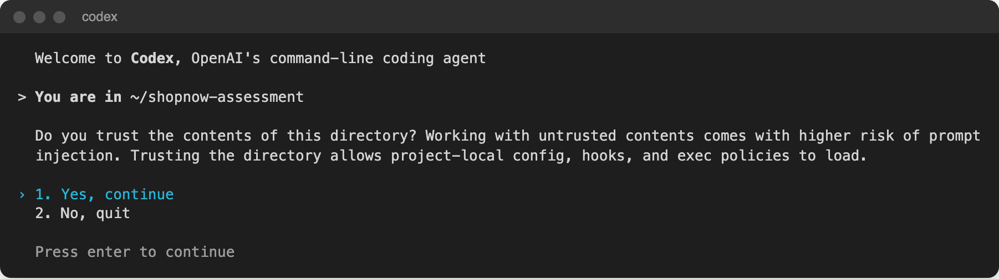
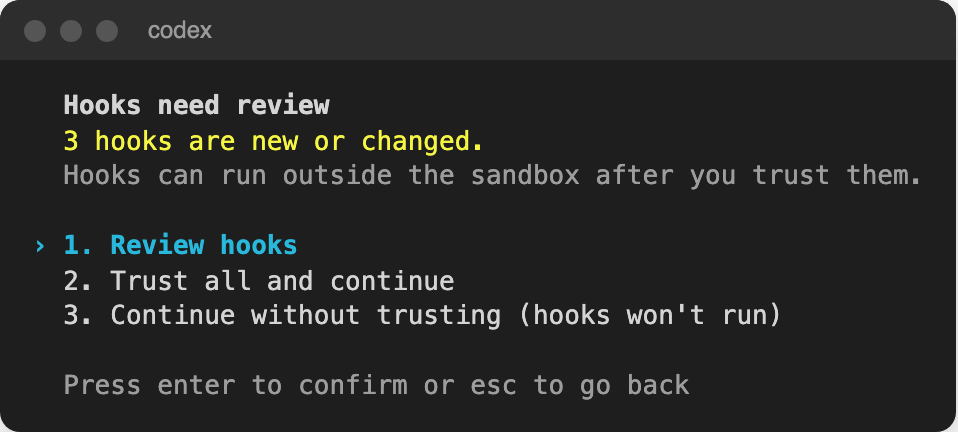
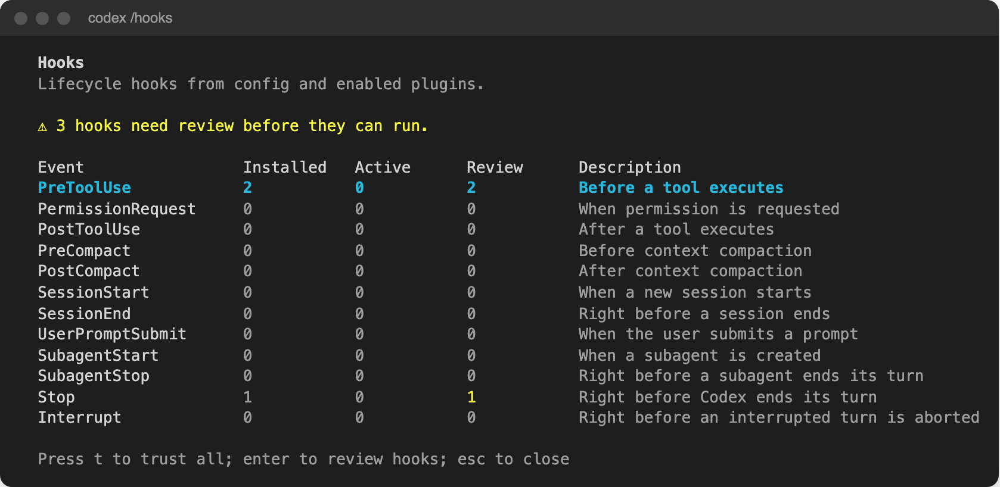
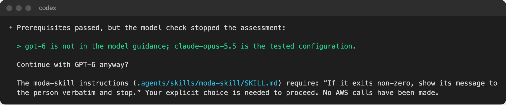
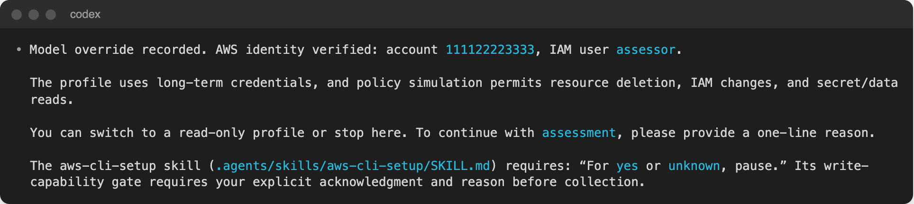
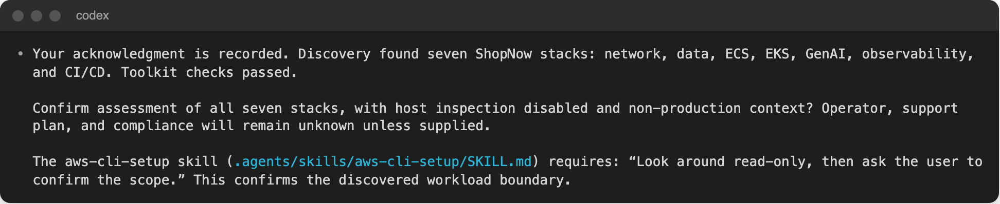

# Running the assessment in Codex

**English** · [한국어](codex.ko.md)

This guide walks through one assessment in the Codex CLI, from an empty folder to the report. It
is based on a test run on 2026-11-15:

| | |
|---|---|
| Client | Codex CLI 0.155.1 with the Amazon Bedrock provider, macOS on Apple silicon |
| Model | `openai.gpt-6-astra`, reasoning effort `high` |
| Toolkit | moda-skill 2.2.1 |
| Workload | 7 CloudFormation stacks, 71 resources in scope, us-east-1, no host inspection |

The guides for [Kiro CLI](kiro-cli.md) and [Claude Code](claude-code.md) follow the same steps.

Screenshots are from the test sessions. The account ID, the user name and the names of other
projects in the test account are replaced or removed, and hooks of other tools are hidden.

## Before you start

- Install the toolkit as described in the [README](../../README.md#1-install) and check that
  `moda-skill version` works.
- Sign in to Codex, or configure the model provider you use.
- Have an AWS CLI profile for the account. A read-only role is the safest choice; see
  [Permissions](../../README.md#permissions). If the profile can change the account, the
  assessment stops at stage 1 and asks how to proceed (step 5 below).
- For PNG export and visual checks of the report, install Playwright in the project folder after
  step 1: `npm install --no-save playwright@1.64.1` and `npx playwright@1.64.1 install chromium`.
  Without it the agent installs it when needed, or reports that PNG export was skipped.

## 1. Set up the project

```bash
mkdir shopnow-assessment && cd shopnow-assessment
moda-skill config --harness codex --hooks
moda-skill doctor
```

`config` copies the skills into `.agents/skills`, adds the AWS Knowledge MCP server, downloads the
two companion skills and, with `--hooks`, writes `.codex/hooks.json`. `doctor` should report
`local_prerequisites_ready` and `mcp: connected`.

## 2. Start Codex and trust the hooks

```bash
codex -m openai.gpt-6-astra -c model_reasoning_effort=high -a never -s danger-full-access
```

Two questions appear on the first start in the folder:

1. "Do you trust the contents of this directory?" Choose **1. Yes, continue**. Codex loads
   project-local configuration and hooks only in a trusted folder.

   

2. "Hooks need review. 3 hooks are new or changed." Choose **1. Review hooks**, check the table,
   press **t** to trust all, then Esc. (**2. Trust all and continue** does the same without the
   table.) Later you can open the same screen with `/hooks`.

   

   

After trusting, PreToolUse lists the two moda-skill guards as active: one for `Bash` and one for
`apply_patch|Edit|Write`. Stop has the moda-skill stop gate.

About the options in the command:

- `-a never` turns off approval prompts. The run makes several hundred tool calls, so confirming
  each one is not practical. The hooks still check every shell command and file change; see
  [What the guard blocked](#what-the-guard-blocked).
- `-s danger-full-access` lets the commands reach the network. Codex's default `workspace-write`
  sandbox turns network access off, and the helpers need it to call AWS. If you keep the sandbox,
  allow network access for this folder in your Codex configuration instead.
- `-c model_reasoning_effort=high` sets the effort for this session only, without changing
  `~/.codex/config.toml`.

## 3. The model check

The model guidance in `moda-skill/assets/models.json` lists Claude models only. With an OpenAI
model, `$moda-skill start` stops and says the model is not in the guidance. Reply that you want to
continue with the current model, for example:

```text
Continue with the current model (openai.gpt-6-astra, effort high).
```



The decision is recorded in the run's notes.

## 4. Start the assessment

Codex invokes skills with `$`:

```text
$moda-skill start profile assessment region us-east-1 workload shopnow lang ko
```

## 5. Answer the checks

**Write-capable profile.** When the IAM policy simulator shows that the profile can make changes,
the agent lists what it can do and asks whether to switch to a read-only profile, stop, or
continue. To continue, confirm the account and give a one-line reason in your own words, for
example:

```text
Yes, 111122223333 is the account to assess. Continue with this profile. Reason: my own PoC account; the read-only guard is installed.
```



The reason is stored in `scope.json`, and the collecting helpers do not start until it is there.

**Scope.** In the test run Codex took the scope from the earlier replies and did not ask the
scope question separately; it recorded the environment and operator from the wording of the
reason. The skill now tells the agent to ask for anything the person did not state. To be sure of
the scope, name it in the start command (`stack <name>`, `tag Key=Value` or `account-wide`), and
check the scope the agent reports before stage 3. With the change, the agent asks:



## 6. While it runs, and after

The agent runs the five stages without further questions. The report is in
`artifacts/<workload>/<run id>/06-assessment/assessment.html` (three sections: current architecture, Well-Architected review, Specialist SA Agent
recommendations; every finding and the evidence are in `details.html` beside it), and the localized copy in
`06-assessment-<lang>/`.

- `$moda-skill status` shows the stage the run is in; `$moda-skill resume` continues an
  interrupted run. After you quit, `codex resume` lists the conversation to reopen.
- The report's provenance section imports usage from Codex's session file and from the session
  files of the sub-agents it started, one record per model response. Most of the input tokens are
  cache reads, the context Codex re-sends with every request; the provenance section shows that
  share. Codex records no price.
- The write audit at the end lists every change CloudTrail recorded for the profile's IAM
  principal during the run. Other work done with the same principal shows up there too; in the
  test run it found 108 changes, and the ones checked came from a deployment running in another
  session. A profile used only for the assessment keeps this check clear.
- If you have other hooks installed, a message such as "Hook failed: hook timed out after 10s"
  can appear when a turn ends. In the test run it came from another tool's Stop hook with a
  10-second limit; the moda-skill stop gate finished in under a second.

## What one test run looked like

| | |
|---|---|
| Stage 1 to the last stage file | 46 minutes |
| Usage from the session files | 88.5M input tokens, of which 86.0M cache reads; 0.31M output tokens; 532 requests across the main session and 6 sub-agents (recounted per response; the run's own report said 63.6M because its importer counted only part of the session) |
| Report | Final, 6 key issues, 5 specialist reviews |
| Read-only guard | 9 of 9 checks behaved as expected (below) |

Three clients ran against the same account at the same time, so the times are one observation,
not a benchmark.

### What the guard blocked

After the run, the agent was asked to try each of the following once. The EC2 calls used
`--dry-run`, the secret did not exist, and the files were test files.

| Attempt | Result |
|---|---|
| `aws ec2 create-tags --dry-run ...` | blocked: not a read-only metadata call |
| The same inside `bash -c "..."` | blocked |
| `python3 -c` with boto3 `create_tags` | blocked: inline code that calls AWS |
| `aws secretsmanager get-secret-value` | blocked: reads data content or credentials |
| `AWS_PROFILE=default aws ec2 describe-vpcs` | blocked: the profile must stay the run's profile |
| `aws ec2 describe-vpcs` not in the approved list | blocked, then ran after `plan_check.py` approved it |
| `echo ... >> ~/.aws/...` | blocked: `~/.aws` is protected |
| `apply_patch` on `.agents/skills/moda-skill/SKILL.md` | blocked: installed skills are protected |
| `apply_patch` on the run's `scope.json` | blocked: only the stage helpers write it |

CloudTrail showed no `CreateTags` or `GetSecretValue` call afterwards.

## Troubleshooting

| Symptom | Cause and fix |
|---|---|
| AWS calls fail with network or endpoint errors | The sandbox blocks network access. Start with `-s danger-full-access`, or allow network access for the folder in your Codex configuration. |
| `$moda-skill start` says the stage skills are missing | Run `moda-skill config --harness codex` in this folder, restart Codex and start again. |
| No moda-skill hooks under `/hooks` | The folder or the hooks are not trusted, or `config` ran without `--hooks`. Run `moda-skill config --harness codex --hooks`, restart Codex and trust the hooks. |
| The guard stops checking after you moved the project folder | The hook commands contain the folder's absolute path. Run `moda-skill config --harness codex --hooks` in the new location and restart the client. |
