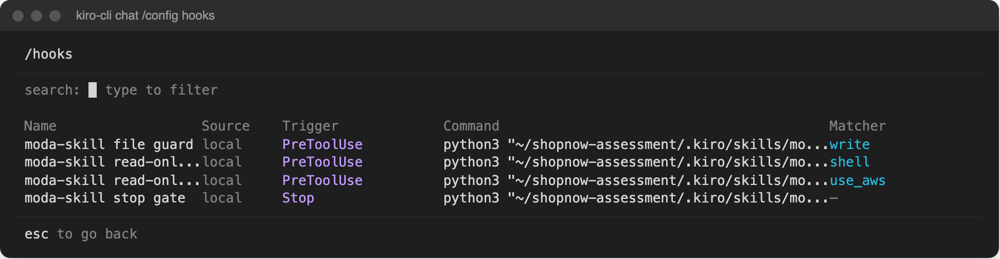
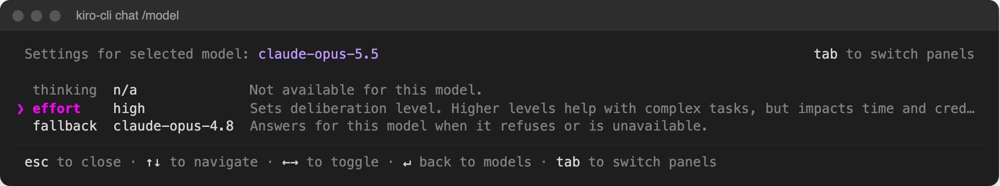
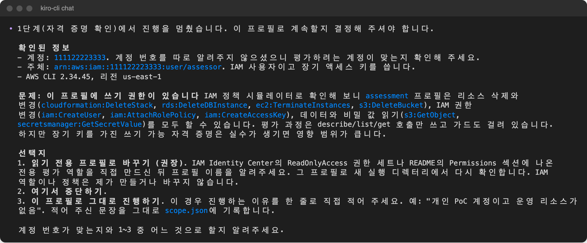
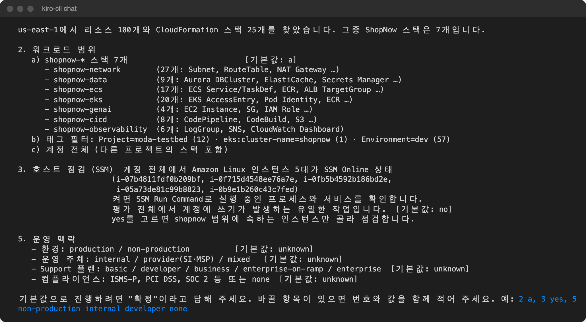

# Kiro CLI에서 평가 실행하기

[English](kiro-cli.md) · **한국어**

빈 폴더에서 시작해 보고서를 받기까지 Kiro CLI에서 평가를 한 번 진행하는 과정을 정리했습니다.
2026-11-15에 실제로 실행한 내용을 바탕으로 합니다.

| | |
|---|---|
| 클라이언트 | Kiro CLI 3.3.0(V3), Apple silicon macOS |
| 모델 | `claude-opus-5.5`, effort `high` |
| 도구 | moda-skill 2.2.1 |
| 워크로드 | CloudFormation 스택 7개, 범위 내 리소스 71개, us-east-1, 호스트 점검 없음 |

[Claude Code](claude-code.ko.md)와 [Codex](codex.ko.md) 가이드도 같은 순서로 구성되어 있습니다.
AWS CloudShell에서 실행한다면 [CLOUDSHELL.md](../CLOUDSHELL.md)를 참고해 주세요.

화면은 테스트 세션에서 캡처했습니다. 계정 ID, 사용자 이름, 테스트 계정에 있는 다른 프로젝트 이름은 다른 값으로 바꾸거나
지웠고, 다른 도구의 훅은 보이지 않게 했습니다.

## 시작하기 전에

- [README](../../README.ko.md#1-설치)의 안내대로 도구를 설치하고 `moda-skill version`이 동작하는지
  확인합니다.
- Kiro CLI에 로그인되어 있어야 합니다(`kiro-cli whoami`).
- 평가할 계정의 AWS CLI 프로필을 준비합니다. 가장 안전한 것은 읽기 전용 역할입니다.
  [권한](../../README.ko.md#권한)을 참고해 주세요. 계정을 변경할 수 있는 프로필이라면 1단계에서
  평가가 멈추고 진행 방법을 묻습니다(아래 5단계).
- 보고서의 PNG 내보내기와 화면 점검에는 Playwright가 필요합니다. 1단계를 마친 뒤 프로젝트 폴더에서
  `npm install --no-save playwright@1.64.1`과 `npx playwright@1.64.1 install chromium`을 실행해 두세요.
  설치하지 않으면 에이전트가 필요할 때 설치하거나, PNG 내보내기를 건너뛰었다고 알려 줍니다.

## 1. 프로젝트 구성

```bash
mkdir shopnow-assessment && cd shopnow-assessment
moda-skill config --harness kiro --hooks
moda-skill doctor
```

`config`는 스킬을 `.kiro/skills`에 복사하고, AWS Knowledge MCP 서버를 추가하고, 보조 스킬 두 개를
내려받습니다. `--hooks`를 지정하면 `.kiro/hooks/moda-skill.json`도 만듭니다. `doctor` 결과에
`local_prerequisites_ready`와 `mcp: connected`가 나오면 준비가 끝난 것입니다.

## 2. Kiro 실행과 훅 확인

```bash
kiro-cli chat
```

워크스페이스를 신뢰할지 물으면 신뢰를 선택해 주세요. 프로젝트 훅은 신뢰한 폴더에서만 실행됩니다.
(`kiro-cli chat --trust-workspace`를 쓰면 이번 실행에 한해 이 질문을 건너뛰며, 설정은 저장되지
않습니다.)

`/config hooks`를 실행해 moda-skill 훅 네 개가 보이는지 확인합니다.

| 이름 | 트리거 | 매처 |
|---|---|---|
| moda-skill read-only guard | PreToolUse | `shell` |
| moda-skill read-only guard | PreToolUse | `use_aws` |
| moda-skill file guard | PreToolUse | `write` |
| moda-skill stop gate | Stop | |



그다음 `/tools trust-all`로 도구별 확인을 끕니다(`kiro-cli chat --trust-all-tools`로 시작해도
됩니다). 평가 한 번에 도구 호출이 수백 번 일어나서 하나하나 승인하기는 어렵습니다. 확인을 꺼도 훅은
모든 셸 명령과 파일 변경을 계속 검사합니다. [가드가 막은 항목](#가드가-막은-항목)을 참고해 주세요.

## 3. 모델과 effort 설정

상태 표시줄에 `claude-opus-5.5 · medium`처럼 모델과 effort가 나옵니다. 이 평가는 effort `high`
이상에서 테스트했습니다.

1. `/model`을 실행하고 `claude-opus-5.5`를 선택한 상태로 둡니다.
2. Tab으로 "Settings for selected model" 영역으로 이동하면 커서가 `effort`에 있습니다.
3. 오른쪽 화살표로 `high`가 될 때까지 바꾸고 Esc를 두 번 누릅니다.

이 설정은 `~/.kiro/settings/cli.json`의 `chat.modelDefaults.claude-opus-5.5.output_config.effort`에
저장되어, 이후 같은 모델을 쓰는 세션에도 적용됩니다.



## 4. 평가 시작

`/moda-skill`을 입력하고 Tab으로 목록에서 명령을 선택한 다음, 나머지 옵션을 이어서 입력합니다.

```text
/moda-skill start profile assessment region us-east-1 workload shopnow lang ko
```

한 줄을 한 번에 입력하면 명령 목록이 다른 항목을 선택하는 경우가 있어서, 먼저 Tab으로
`/moda-skill`을 확정하는 방법을 권합니다.

## 5. 확인 질문에 답하기

에이전트는 사람이 정해야 하는 항목에서만 멈춥니다. 테스트에서는 두 번 멈췄습니다.

**계정을 변경할 수 있는 프로필.** IAM 정책 시뮬레이터로 확인한 결과 프로필에 변경 권한이 있으면,
에이전트가 가능한 작업을 알려 주고 세 가지 선택지를 제시합니다. 읽기 전용 프로필로 바꾸기,
중단하기, 이 프로필로 계속하기입니다. 계속하려면 번호와 함께 이유를 직접 한 줄로 적어 주세요.

```text
3번, 이 프로필로 계속합니다. 이유: 본인 소유 PoC 계정이고 읽기 전용 가드를 설치했습니다.
```



이유는 `scope.json`에 기록되며, 기록되기 전까지 수집 헬퍼는 실행되지 않습니다.

**평가 범위.** 에이전트가 계정을 읽기 전용으로 둘러본 뒤, 리전, 워크로드(스택, 태그 또는 계정
전체), 호스트 점검, 보고서 언어, 배경 정보(환경, 운영 주체, Support 플랜)를 번호를 매긴 메시지
하나로 보여 줍니다. 바꿀 항목만 적어 답하면 됩니다. 예를 들어
`2 a, 3 아니요, 5 non-production internal unknown unknown`처럼 적거나, 기본값 그대로라면
`확정`이라고 답합니다.



## 6. 실행 중과 실행 후

이후에는 추가 질문 없이 다섯 단계가 진행됩니다. 보고서는
`artifacts/<workload>/<run id>/06-assessment/assessment.html`에, 요청한 언어로 만든 보고서는
`06-assessment-<lang>/`에 생깁니다.

- `/moda-skill status`로 진행 중인 단계를 확인하고, `/moda-skill resume`으로 중단된 실행을 이어갈 수
  있습니다. 종료 후에는 종료할 때 출력되는 `kiro-cli chat --resume-id <id>`로 대화를 다시 열 수
  있습니다.
- Kiro는 턴이 끝날 때 모델 사용량을 기록합니다. 평가 대부분이 긴 턴 하나에서 진행되기 때문에, 그
  턴에서 작성한 보고서에는 이전 턴의 사용량만 들어갑니다. 실행이 끝난 뒤 `/moda-skill report`를
  실행하면 전체 사용량으로 보고서를 다시 만듭니다.
- 마지막의 쓰기 감사는 실행 동안 CloudTrail에 기록된, 프로필의 IAM 주체가 만든 변경을 모두
  보여 줍니다. 같은 주체로 한 다른 작업(예: 다른 Kiro 세션의 배포)도 함께 나타납니다. 테스트에서는
  170건이 나왔고, 확인한 이벤트는 같은 시각 다른 Kiro 세션에서 진행된 배포였습니다. 평가에만 쓰는
  프로필을 사용하면 이 확인 결과가 깨끗하게 나옵니다.

## 테스트 실행 결과

| | |
|---|---|
| 1단계부터 마지막 단계 파일까지 | 145분 |
| Kiro 크레딧(세션 전체) | 632.64 |
| 보고서 | Final, 핵심 문제 6개, 분야별 검토 5개 |
| 읽기 전용 가드 | 9개 항목 모두 의도대로 동작(아래) |

세 클라이언트를 같은 계정에서 동시에 실행했기 때문에, 소요 시간은 한 번 관찰한 값일 뿐
벤치마크는 아닙니다.

### 가드가 막은 항목

평가가 끝난 뒤 에이전트에게 아래 항목을 한 번씩 시도하게 했습니다. EC2 호출에는 `--dry-run`을
붙였고, 시크릿은 존재하지 않는 이름이며, 파일은 테스트용입니다.

| 시도 | 결과 |
|---|---|
| `aws ec2 create-tags --dry-run ...` | 차단: 읽기 전용 메타데이터 호출이 아님 |
| 같은 명령을 `bash -c "..."` 안에서 실행 | 차단 |
| boto3 `create_tags`를 호출하는 `python3 -c` | 차단: AWS를 호출하는 인라인 코드 |
| `aws secretsmanager get-secret-value` | 차단: 데이터 내용이나 자격 증명을 읽는 호출 |
| `AWS_PROFILE=default aws ec2 describe-vpcs` | 차단: 이번 실행의 프로필만 사용 가능 |
| 승인 목록에 없는 `aws ec2 describe-vpcs` | 차단된 뒤, `plan_check.py` 승인을 받고 실행됨 |
| `echo ... >> ~/.aws/...` | 차단: `~/.aws`는 보호 대상 |
| 파일 도구로 `.kiro/skills/moda-skill/SKILL.md` 수정 | 차단: 설치된 스킬은 보호 대상 |
| 파일 도구로 실행의 `scope.json` 수정 | 차단: 단계 헬퍼만 기록 가능 |

이후 CloudTrail에도 `CreateTags`나 `GetSecretValue` 호출은 없었습니다. 이 세션에는 `use_aws`
도구가 없어서 `use_aws` 훅은 이번 테스트에서 동작을 확인하지 못했습니다.

## 문제 해결

| 증상 | 원인과 해결 |
|---|---|
| 셸 명령이 "Command timed out after 120000ms"로 끝남 | 명령이 셸 도구의 제한 시간(테스트 환경에서 120초)을 넘었습니다. 리소스가 많은 계정에서는 범위 탐색이 이 시간을 넘기곤 했는데, 지금은 호출을 병렬로 실행해 리전 하나에 약 20초, 기본 리전 전체에 약 45초가 걸렸습니다. `start`에서 리전을 지정하면 더 짧아집니다. |
| `/moda-skill start`가 단계 스킬이 없다고 안내함 | 이 폴더에서 `moda-skill config --harness kiro`를 실행하고 Kiro를 다시 시작한 뒤 시도해 주세요. `~/.kiro/skills`의 스킬을 복사해 쓰지 마세요. |
| 모델 확인 단계에서 멈춤 | 3단계처럼 모델이나 effort를 바꾸고 다시 시작하거나, 현재 설정으로 계속하겠다고 답합니다. |
| `/config hooks`에 moda-skill 훅이 없음 | 폴더를 신뢰하지 않았거나 `config`를 `--hooks` 없이 실행한 경우입니다. `moda-skill config --harness kiro --hooks`를 실행하고 Kiro를 다시 시작해 주세요. |
| 프로젝트 폴더를 옮긴 뒤 가드가 동작하지 않음 | 훅 명령에 폴더의 절대 경로가 들어 있습니다. 새 위치에서 `moda-skill config --harness kiro --hooks`를 실행하고 클라이언트를 다시 시작해 주세요. |
